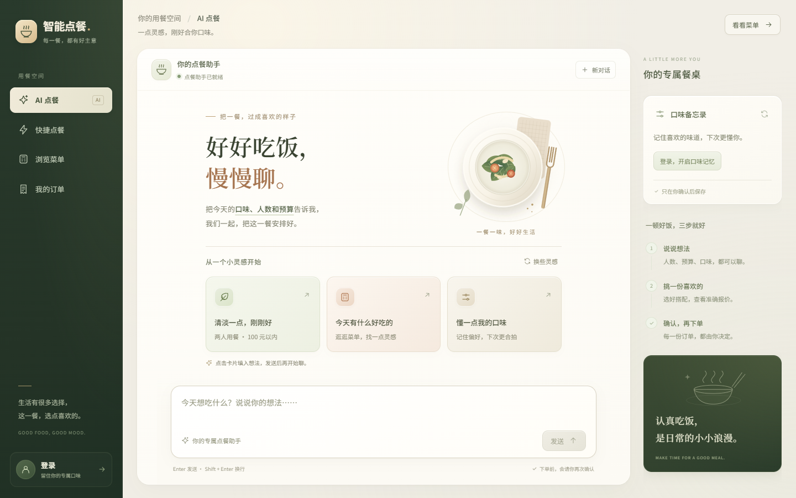
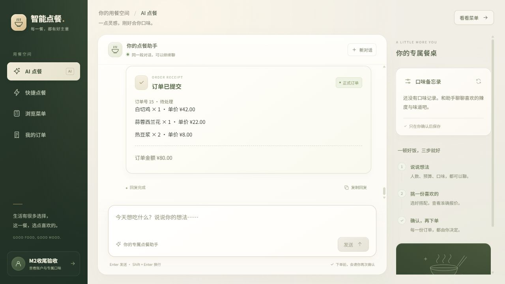
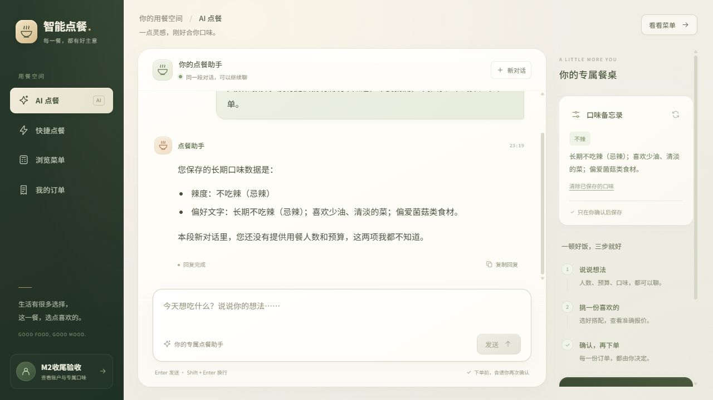
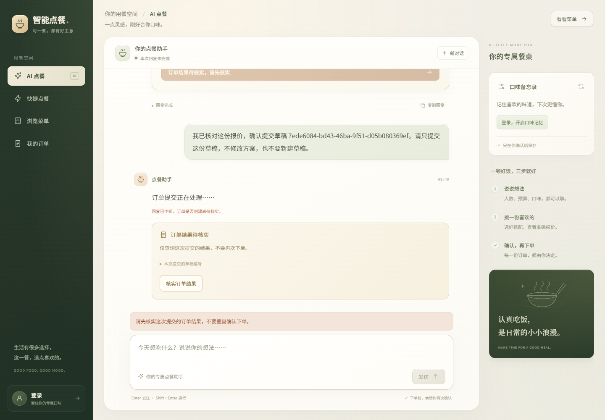
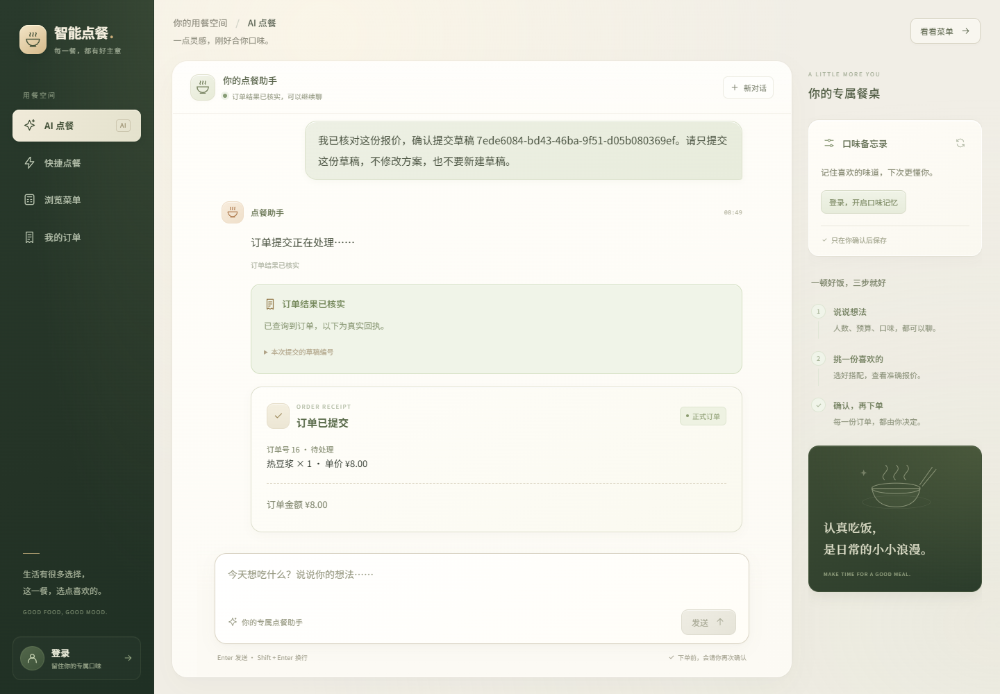
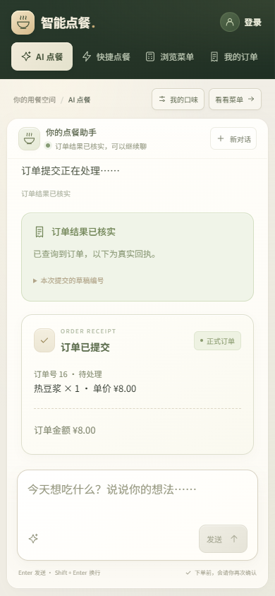
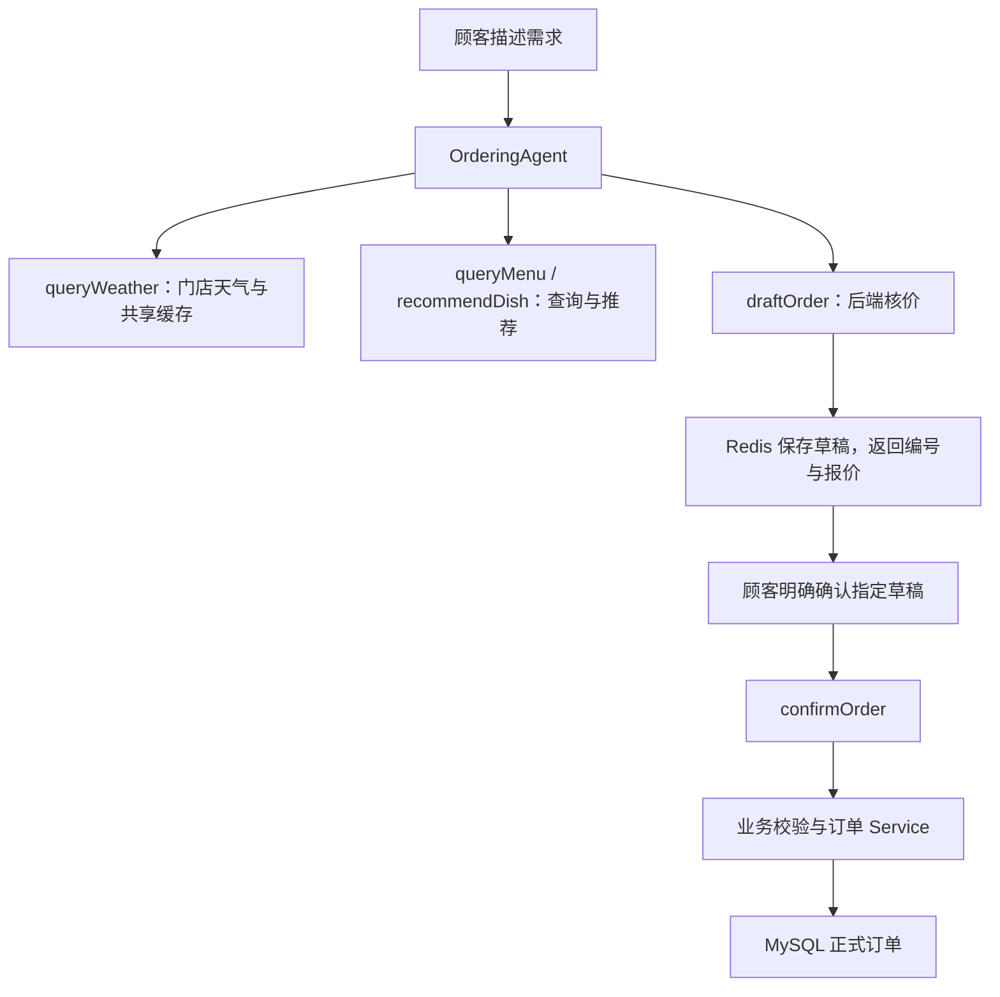

# 智能点餐系统 · V2 Agent

[](https://github.com/MissWT-eng/smart-ordering-system/actions/workflows/ci.yml)

基于 **Java 17、Spring Boot 4、LangChain4j 和 DeepSeek** 的点餐助手。顾客通过文字或录音描述需求，Agent 检索菜品并调用业务工具；后端按真实价格核算草稿，用户确认后创建订单，完成的回复支持按需朗读。

项目保留 V1 的菜单、推荐、订单和反馈接口，V2 在现有 Service 之上增加工具调用与草稿确认流程。

> **当前进度（2026-11-03）**：M2 核心点餐与记忆流程已完成分阶段验收。近期新增中断后的订单结果核实、可信身份参与评分重排、60 道演示菜品，以及阿里云语音输入和龙安欢按需朗读。朗读已完成真实前后端联调，语音输入已通过浏览器 WebM 编码与真实云端识别验证；真人麦克风完整体验仍单独确认。待办与验收范围见[阶段清单](docs/m2-refinement-todo.md)。

项目重点是把模型工具调用落到可核验的业务流程：**身份来自后端，价格来自数据库，订单以真实回执为准**。当前为单门店、单实例演示项目，真实支付、商户运营 Agent、多实例共享记忆尚未接入。

[功能与流程](#已实现的功能) · [接口与示例](#主要接口) · [本地运行](#本地运行) · [验证范围](#验证与已知边界) · [后续计划](#当前边界与后续计划)



<details>
<summary>查看真实下单与画像跨会话验收截图</summary>

下图来自真实页面、模型和数据库联调：明确确认后创建 80 元订单；新对话读取长期口味，但不继承上一段的临时人数和预算。专用测试数据已在验收后清理。





</details>

<details>
<summary>查看订单回复中断后的核实入口与手机布局</summary>

以下截图来自隔离浏览器回归：确认回复中断时保留待核实入口，通过只读查询展示订单回执，不自动重复下单。







</details>

## 技术栈

版本以 [pom.xml](pom.xml) 和 [应用配置](src/main/resources/application.yml) 为准。

| 层次 | 当前选型 | 用途 |
| --- | --- | --- |
| 语言与构建 | Java 17、Maven Wrapper | 后端开发与构建 |
| Web 框架 | Spring Boot 4.0.8、Spring MVC | REST 接口、参数校验、统一响应、SseEmitter 流式输出 |
| 数据访问 | MyBatis Spring Boot Starter 4.0.1、MySQL | 菜品、订单、用户、长期口味画像、推荐记录与反馈持久化 |
| 缓存与临时状态 | Redis、Spring Data Redis、Lua | 用户令牌、订单草稿、会话归属与实例元数据、原子校验及续期、按城市共享的天气缓存 |
| Agent 编排与记忆 | LangChain4j 1.19.0；Spring Boot 4 Starter 1.19.0-beta29 | AI Services、工具调用、`@MemoryId` 与窗口记忆 |
| 本地生命周期管理 | Spring `@Scheduled`、`ConcurrentHashMap`、`Semaphore` | 同会话并发拒绝、缓存会话总量限制、使用状态跟踪与空闲过期记忆清理 |
| 对话模型 | DeepSeek `deepseek-chat` | 意图分析、推荐理由、工具选择与回复 |
| 向量化模型 | BGE-M3（硅基流动 `Pro/BAAI/bge-m3`） | 菜品文本与查询向量化 |
| 向量检索 | Qdrant；LangChain4j Qdrant 模块 1.19.0-beta29 | 语义召回、辣度与分类等元数据过滤 |
| 外部数据 | 和风天气 API | 独立天气工具与推荐上下文，结构化返回、超时与失败降级 |
| 语音服务 | 阿里云百炼：`qwen3-asr-flash`、`cosyvoice-v3-flash` / `longanhuan` | 录音识别为可编辑文字；首次点击合成朗读，页面内重播复用音频 |
| 对象映射与校验 | MapStruct 1.6.3、Lombok、Jakarta Validation | DTO 映射、参数约束 |
| 前端 | 原生 HTML / CSS / JavaScript、ES Modules、MediaRecorder / Audio | SSE 聊天、报价编辑、订单核实、画像管理、录音与朗读；保留 V1 入口 |

## 已实现的功能

### V1：基础点餐与检索推荐

- **用户与游客**：手机号识别注册用户，签发 Redis 令牌；游客可以查看菜单、获取推荐和创建订单。
- **菜单管理**：商户维护菜品信息和上下架状态，支持菜品向量同步及全量重建。
- **RAG 推荐**：偏好分析 → 向量召回与元数据过滤 → 数据库核对在售菜品 → 候选排序与预算筛选 → 结合天气生成推荐理由。
- **反馈重排**：推荐接口与 Agent 推荐工具均接通可信用户身份，可结合本人历史菜品评分调整候选顺序；游客不使用注册用户历史评分。
- **订单与反馈**：创建订单、保存明细价格快照、分页查询历史订单、提交菜品反馈。
- **状态与鉴权**：订单支持 `pending → paid / cancelled` 状态流转；用户信息、历史订单等受保护接口校验令牌与归属，商户接口使用独立令牌。当前没有接入真实支付。

### V2：工具调用与草稿确认

入口为 `POST /agent/chat` 和 `POST /agent/chat/stream`，由同一个 `OrderingAgent` 调用 `DishTools` 中的六个工具：

| 工具 | 职责 | 返回结果 |
| --- | --- | --- |
| `queryMenu` | 查询当前在售菜单 | 菜品编号、名称、价格、分类与简介 |
| `queryWeather` | 查询配置的门店城市当前天气，辅助回答天气问题或推荐 | 状态、城市、天气、温度、观测时间及获取时间；失败时说明服务不可用 |
| `recommendDish` | 根据偏好、人数与可选预算获取候选菜品 | 候选菜、单价和推荐理由 |
| `draftOrder` | 按菜品编号、数量和可选预算试算，并保存 Redis 草稿 | 明细、单价、小计、总额、超预算标记、草稿编号和有效期 |
| `confirmOrder` | 验证明确确认与草稿归属，调用订单 Service | 正式订单编号、状态、金额与明细，或业务失败原因 |
| `proposeUserPreference` | 整理待确认的长期口味，校验并保留未修改的画像字段 | 候选、状态与后续指引；不直接保存画像 |

推荐阶段的预算筛选目前是**候选菜品单价不高于预算**；组合总价由 `draftOrder` 根据选定数量与真实菜价，使用 `BigDecimal` 核算。超预算草稿可以返回给用户查看，但确认阶段会拒绝下单。

推荐工具描述、内层推荐模型和外层 Agent 已统一输出规则：推荐阶段展示候选菜品及单价；用户要求不试算时，不生成草稿、不自行汇总组合金额或给出整单预算结论。用户指定推荐数量仍待程序化约束，当前最多返回 5 道候选不等于支持任意指定数量。



确认流程包含以下约束：

- **后端提供身份**：游客归属来自 HTTP Session；注册用户归属来自已解析的 `X-User-Token`。
- **明确确认目标**：请求中的 `confirmedDraftId` 经后端上下文传递，必须与工具参数 `draftId` 一致。缺少确认或编号不一致时停止下单。
- **草稿有效期**：默认保存 15 分钟；确认新订单前检查归属、期限、预算、当前在售状态和菜品价格。
- **价格一致性**：创建订单时再次校验草稿单价，按本次查询的价格计算金额并保存明细快照。价格变化后需要重新试算、重新确认。
- **重复提交处理**：按 `draftId` 查找已有订单并校验归属；并发创建遇到唯一键冲突时查询并返回已有订单，依赖数据库的 `orders.draft_id` 唯一索引。
- **草稿操作互斥**：当前单实例中，修改与确认共用按 `draftId` 管理的处理资格；同一草稿处理中的竞争请求返回 HTTP 409。操作结束后重复确认仍查询并返回已有订单。
- **失败结果**：未确认、编号不一致、超预算、菜品下架、草稿失效或归属不符时，返回业务原因与后续处理建议。

### M2：报价卡编辑与当前报价上下文

- **数量与删除**：AI 报价卡支持每菜 1～50 份、删除和恢复原报价；请求至少保留一项，最多 20 项。首版只允许原草稿中的菜号，拒绝重复条目，换菜另行推进。
- **服务端核价**：`POST /order-drafts/{draftId}/revisions` 接收修改后的完整 `orderItems`。归属来自 token 或游客 Session，预算继承原草稿，价格从数据库读取；返回新编号、有效期和真实报价，不返回 `ownerKey`。超预算仍可生成报价，确认下单时继续拒绝超预算草稿。
- **原子替换**：Lua 在 Redis 中检查旧草稿归属、存在性及替换状态，再保存新草稿并记录旧草稿的 `replacedByDraftId`，保留旧草稿剩余 TTL。通过该接口替换的旧报价不能再修改或确认；单实例 Guard 协调替换与真实下单之间的竞争。
- **前端确认边界**：编辑后金额显示为待核价并禁用确认；重新报价成功后展示后端返回的新卡片，再由用户明确确认新编号。网络、超时、5xx 或不完整成功响应视为结果待核实，不自动重试写请求，也不继续确认旧价。
- **续聊读取新报价**：后续聊天携带 `currentDraftId`，后端按当前身份读取草稿，仅将编号、有效期和报价注入 Agent。草稿过期或已替换时传入不可用状态，普通聊天仍可继续；越权仍返回 403。`currentDraftId` 表示讨论对象，`confirmedDraftId` 才表示本次明确确认目标，两者分别校验。

替换、互斥与 HTTP/模型续聊检查覆盖旧报价失效、新数量和金额读取、预算继承及游客隔离，范围和限制见[验证记录](docs/m2-draft-revision-verification.md)。

### M2：中断后的订单结果核实

- **结果待核实**：已发送明确确认请求，却未收到可靠回执或明确拒绝时，页面保留该次提交的草稿编号，提供“核实订单结果”。普通聊天中断不展示下单核实入口。
- **只读查询**：`GET /order-drafts/{draftId}/order` 按当前可信身份读取 MySQL 订单，不依赖 Redis 草稿仍然存在，也不重新提交订单。未查到时保持待核实，可稍后再次查询。
- **身份恢复**：凭证过期时保留原提交归属，原账号重登后继续查询；切换账号则清理旧账号状态，旧 token 的迟到响应不会清掉新身份。
- **首版范围**：当前页面保留恢复状态；刷新页面后的持久恢复仍待实现。26 项隔离浏览器回归范围见[前端验证记录](docs/m2-frontend-verification.md)。

### M2：推荐与评分反馈

推荐链路为 **偏好解析 → 带约束召回 → 在售核验与单价预算筛选 → 本人反馈重排 → 返回候选与理由**。

- 召回数和返回数分别配置，当前为 20 / 5；启动时校验正数及两者关系，减少先取少量菜再筛预算造成的候选损失。
- 偏好解析失败会明确返回不可用；受约束检索为空时保留用户限制，不改成无条件查询。
- 同步和 SSE 入口通过 `InvocationParameters` 传递已校验的用户编号与凭证，工具将可信身份交给推荐 Service；凭证不进入模型参数或提示词。
- 评分请求从 `X-User-Token` 获取本人编号，覆盖请求体可能传入的身份。真实评分与推荐对照中，相同向量候选下高分菜提升、低分菜退出前五，游客结果不受该用户评分影响。

当前完成的是**具体菜品反馈参与候选重排**。同次评价修改、相似新菜偏好泛化、适度尝新和推荐效果评测留作后续，见[改进清单](docs/m2-refinement-todo.md#7-推荐基础链路与评分反馈首版已完成)。

### M2：门店天气与共享缓存

- **独立工具**：`queryWeather` 返回 `WeatherToolResult`，成功时包含 `WeatherInfoDTO`，失败时返回 `SERVICE_UNAVAILABLE`。只问天气时不继续推荐、试算或下单；天气建议服从用户明确的口味、忌口与预算。
- **统一来源**：工具、天气 Controller 和推荐 Service 共用 `WeatherService.obtainCurrentWeather()`；旧的字符串方法仅负责转换与推荐场景的失败降级，外部请求集中在 `fetchCurrentWeather()`。
- **缓存策略**：Redis Key 为 `weather:current:<cityId>`，Value 为天气 DTO 的 JSON；`weather.cache-ttl-seconds` 默认配置为 300 秒。命中后直接复用，不续期、不修改观测时间与获取时间；过期后由下次请求重新查询。
- **失败处理**：缓存读取、JSON 解析或字段校验失败时继续请求天气；写缓存失败仍返回已取得的天气。天气接口失败保留业务异常，不写失败缓存，推荐可以继续按口味与预算执行。
- **首版范围**：城市名称与编号来自 YAML，当前配置为长春；仅支持门店当前天气，不提供任意城市查询或天气预报。缓存有效期与上游观测时间分别保留，不把读取缓存的时间当成新观测时间。

缓存边界与真实 HTTP 检查覆盖不同游客、不同会话、推荐链路和 SSE；TTL 数据与已知边界见[天气验证记录](docs/m2-weather-verification.md)。

### M2：短期会话记忆与生命周期

- **会话编号**：首次请求不传 `conversationId`，后端生成 UUID；后续请求携带返回的编号，继续同一段聊天。同一身份可开启多段独立聊天。
- **会话归属与实例**：Redis 的 `chat:conversation:<conversationId>` 保存 `ownerKey`、`instanceId` JSON。复用编号前检查归属；编号不存在或过期返回 HTTP 404，归属不一致返回 HTTP 403。
- **聊天上下文**：`@MemoryId` 将会话编号交给 `chatMemoryProvider`，每段聊天使用独立的 `MessageWindowChatMemory`，最多保留 20 条消息，包含系统和工具消息。
- **实例失效提示**：每次应用创建会话 Service 实例时生成一个实例编号。本人会话的编号与当前实例不同，返回 HTTP 409 和“对话上下文已失效，请开启新对话”；其他身份优先返回 403。旧格式纯 ownerKey 记录也会被拒绝，不自动恢复旧聊天。
- **存储边界**：聊天内容保存在当前 Java 进程内，Redis 保存会话元数据；重启仍会丢失本机聊天上下文，实例校验只识别失效，不恢复消息。尚未支持多实例共享聊天记忆或完整历史归档。
- **有效期**：`auth.conversation-ttl-minutes` 默认 30 分钟；归属与实例校验通过后，Lua 在同一次执行中刷新 TTL。过期、越权和实例失效请求不续期、不自动重建旧编号。
- **同会话并发**：当前单实例中，同一编号同时只允许一条消息进入 Agent，其余返回 HTTP 409，不写入模型记忆；不同会话可同时处理。忙碌判断位于续期之后，因此忙碌请求可能已刷新 TTL。
- **清理机制**：请求开始时登记使用计数，并再次检查 Redis 会话存在；同步请求在 `finally` 中归还计数，流式请求在模型任务终止后归还。定时任务每轮结束后等待 60 秒，清理计数为零且会话已不存在的记忆；成功后归还缓存容量许可并移除本地跟踪记录。
- **调用与故障保护**：正在执行的调用结束后再清理；Redis 检查失败时保留记录，后续重试。使用计数和清理通过同一编号的 `compute` 操作协调。
- **入口边界**：同步与流式请求共享 `Semaphore(4)`，许可不足返回 HTTP 503；`message` 最多 2000 字。另以独立许可限制本机缓存会话总数，`auth.max-cached-conversations` 默认 100；满额拒绝新会话，已有空闲会话可续聊，请求结束不立即释放缓存名额。此限制不等于 Redis Key 数或 JVM 字节上限，详见[容量验证记录](docs/m2-capacity-verification.md)。

聊天记忆不代替订单报价、身份或本次确认授权。跨轮确认正式订单仍须提交 `confirmedDraftId`，后端继续检查草稿、归属、预算和菜价。

### M2：长期口味画像与待确认候选

- **本人画像管理**：MySQL `user_preference` 每个用户最多一条画像，保存 `spicyLevel`、最多 200 字的 `preferenceText` 和创建、更新时间；提供查看、整份替换保存和删除接口。
- **可信身份**：用户编号由 `X-User-Token` 解析；Controller 将用户编号与原画像通过 `InvocationParameters` 传给工具，模型只提供口味字段。游客不能管理注册用户画像。
- **默认口味**：每轮聊天读取当前画像，仅将两个口味字段整理为 JSON，通过 `@V("profileContext")` 注入提示词。本轮明确要求优先于普通长期偏好，临时人数、预算和口味不会自动持久化。
- **空值语义**：没有画像时传入 `{}`；辣度 `null` 表示未知，`none` 表示明确偏好不辣。画像 PUT 为整份替换，字段省略或传 `null` 都会清空对应值，删除画像可重复执行。
- **候选生成**：`proposeUserPreference` 仅处理长期口味候选；未传的工具参数保留原字段，补充说明传入更新后的完整文本。主动执行 Bean Validation，空白、无有效输入或超长文本返回 `INVALID_ARGUMENTS`，游客返回 `LOGIN_REQUIRED`。
- **确认边界**：工具成功表示候选已生成，尚未保存。聊天响应的 `proposalToolResult` 来自本轮真实工具执行对象，以最后一次候选调用为准，普通聊天时为空。前端展示完整候选，点击“确认保存口味”后再调用独立画像 PUT；清除画像也需单独确认。聊天文本中的“确认”不会直接保存。

本人画像读写、候选工具及真实 HTTP 行为已分阶段验证，范围见[长期画像验证记录](docs/m2-preference-verification.md)。

### M2：SSE 流式回复

`POST /agent/chat/stream` 接收与同步聊天相同的 JSON 请求，返回 `text/event-stream`。通过 LangChain4j `TokenStream` 接收模型增量，按 `meta → delta… → done` 输出；模型失败时以 `error` 结束。`done` 包含完整 `AgentChatResponse`，其中 `reply` 是最终回复，`proposalToolResult` 是本轮候选工具结果。

入口鉴权、会话和参数错误在流开始前返回 HTTP 错误状态与 JSON；流开始后的模型错误通过 SSE `error` 返回。连接超时为 60 秒，超时或断连只关闭输出，模型或工具真实结束后才归还会话计数与并发许可。没有收到 `done` 时应视为回复未完成，不能据此判断订单是否创建，也不能自动重放下单请求。协议示例与测试范围见 [SSE 验证记录](docs/m2-sse-verification.md)。

### M2：Agent 用户界面

默认首页为 AI 点餐，使用 fetch POST 读取 SSE，支持连续聊天、新对话、停止接收和中断提示。`done` 的 `draftToolResult`、`orderToolResult` 与 `proposalToolResult` 均来自实际工具对象，不从模型文字提取编号或金额。

报价卡展示菜品、份数、单价、小计、预算及有效期；用户核对后打开确认弹窗，再明确提交同一 `confirmedDraftId`。超预算、过期或被新试算替代的报价不能从旧按钮提交，最终仍由后端核验。正式订单展示真实回执；游客回执按订单号去重并保存到既有本机订单区。

保留快捷点餐、浏览菜单和历史订单入口。菜单支持菜名/简介搜索、分类组合筛选与价格排序，本地已选清单可调整数量；它与 AI 草稿报价分别管理。AI 首页提供可切换的本地灵感卡，阅读历史消息时保留滚动位置并提示新回复。身份切换会结束当前接收并清空页面对话及当前草稿引用；同页切换保留聊天，刷新页面开启新对话，目前没有历史聊天列表。界面、截图和实现阅读顺序见[前端说明](docs/m2-frontend-verification.md)。

### M2：语音输入与按需朗读

- **语音输入**：登录后录音，最长 60 秒、最大 5MiB。WebM/Opus 或 Ogg 上传后识别为可编辑文字，用户检查并手动发送；识别期间修改了原文时，结果单独保留，不覆盖输入、不自动提交。
- **资源清理**：取消、设备异常、账号或会话变化会释放麦克风并丢弃迟到结果；浏览器权限不可用时仍可打字。
- **回复朗读**：只为完成的回复提供朗读，首次点击调用 `cosyvoice-v3-flash + longanhuan`，音频下载为页面内 Blob 后支持停止和重播。开始录音会停止播放或取消合成等待。
- **事实来源**：报价和订单优先读后端结构化摘要，过滤 Markdown、内部 UUID 与 URL；下单拒绝、待核实和已核实回执各自采用可靠状态。后端仅接收文字，模型、音色和风格指令由服务端配置。
- **当前体验**：真实朗读联调及菜名、金额、份数读音、声音与语速已获手动体验确认；首播有时偏慢，待分阶段计时后再优化。语音输入的真人麦克风完整链路仍待单独确认。

鉴权、浏览器与云端检查的区别见[语音验证记录](docs/m2-speech-verification.md)。

## 当前边界与后续计划

| 项目 | 当前状态 |
| --- | --- |
| Agent 六个工具与确认流程 | 四个核心点餐工具、口味候选和天气工具已接入；主要拒绝、身份、重试、并发场景已联调，完整故障恢复与 V1 回归待补齐 |
| 跨请求聊天记忆 | 已接入；多轮记忆、游客与两个注册用户之间的隔离、同用户换 token 续聊已验证 |
| 会话过期与本机清理 | 已实现滑动有效期、定时清理和调用中保护；已有真实 HTTP 与受控程序分阶段验证 |
| 自动续期与同会话并发消息 | Lua 原子校验及续期已实现；单实例同会话忙碌时明确拒绝，不同会话可并行 |
| 重启后上下文失效提示 | 已实现实例编号检查和旧格式拒绝；通过实例切换模拟与 HTTP 检查，未执行真实进程重启演练 |
| 长期口味画像 | 本人 CRUD、Agent 读取、候选与独立 PUT 已验证；真实页面确认保存、新对话读取、取消清除及明确清除通过 |
| SSE / 流式响应 | 后端与前端已接通；正常、错误、断流及取消接收的验证范围分别记录，不自动重放写请求 |
| 并发与容量 | 两种入口共享 4 个在途许可；本机缓存会话默认上限 100，空闲过期清理归还名额，受控与真实 HTTP 验收通过 |
| Agent 前端 | 默认 AI 点餐页已接入；新版真实页面多轮调整、报价、明确下单及画像闭环通过，V1 入口继续保留 |
| Agent 个性化推荐 | 长期口味默认上下文与可信用户身份已接通；本人历史评分参与候选重排，改分规则及相似菜品泛化待完善 |
| 推荐输出规范 | 报价边界的两个真实样例回归通过；请求 2～3 道菜时仍出现列出 4 道的数量偏差，待优化 |
| 天气工具与共享缓存 | 独立工具、门店城市天气与 300 秒 Redis 缓存已验证；支持失败降级，命中不续期，保留真实观测时间 |
| 报价编辑与续聊 | 数量调整、删除、重新核价、原子替换及新报价上下文已接通；中断后的订单结果核实首版已完成，换菜与刷新页面后的待核实状态恢复待做 |
| 语音输入与回复朗读 | 两个接口与前端已接通，TTS 真实联调与首版听感已确认；ASR 真人麦克风体验及首播延迟优化保留后续 |
| 商户页面 | 仓库根目录提供界面原型，尚未接入后端 |
| 支付、取消、历史查询工具 | Agent 尚未提供这些工具；订单管理接口与真实支付接入是不同能力 |

后续任务见 [项目待办](docs/TODO.md)，阶段规划见 [V2 需求文档](docs/v2-requirements.md)。

## 主要接口

| 方法 | 路径 | 说明 | 身份要求 |
| --- | --- | --- | --- |
| POST | `/agent/chat` | V2 自然语言点餐与工具调用 | 支持游客；注册用户传令牌 |
| POST | `/agent/chat/stream` | V2 SSE 流式回复，最终事件包含结构化候选 | 支持游客；注册用户传令牌 |
| POST | `/order-drafts/{draftId}/revisions` | 修改原草稿数量或删除项，继承预算并生成新报价 | 本人草稿；游客保留 Session，注册用户传令牌 |
| GET | `/order-drafts/{draftId}/order` | 只读核实本次确认的订单，返回 `found` 或 `not_found` | 当前身份须与原草稿/订单归属一致 |
| POST | `/speech/recognize` | multipart 字段 `audio`，返回识别文字 `data.text` | 注册用户令牌 |
| POST | `/speech/synthesize` | JSON 字段 `text`，返回音频地址、模型和音色 | 注册用户令牌 |
| GET | `/weather` | 查询结构化门店天气，共用短时缓存 | 当前需有效用户令牌；游客可通过 Agent 查询 |
| GET | `/dishes`、`/dishes/{dishNumber}` | 菜单列表、菜品详情 | 公开 |
| POST | `/recommendations` | V1 智能推荐 | 支持游客；个性化推荐需用户身份 |
| POST | `/orders` | V1 创建订单 | 公开；传入 userId 时检查用户存在及状态 |
| GET | `/orders/{userId}` | 分页查询历史订单 | 用户令牌与归属校验 |
| POST | `/feedback` | 提交菜品反馈，用户编号由令牌确定 | 注册用户令牌 |
| POST | `/users/identify` | 手机号识别并签发令牌 | 公开 |
| GET | `/users/{userId}` | 用户信息 | 用户令牌与归属校验 |
| GET | `/users/me/preference` | 查看本人长期口味，无记录时返回 `data: null` | 注册用户令牌 |
| PUT | `/users/me/preference` | 整份保存或替换本人画像，返回持久化后的画像 | 注册用户令牌 |
| DELETE | `/users/me/preference` | 删除本人画像，重复删除可成功结束 | 注册用户令牌 |
| POST | `/admin/dishes` | 新增菜品 | 商户令牌 |
| PUT | `/admin/dishes/{dishNumber}` | 更新菜品 | 商户令牌 |
| PUT | `/admin/dishes/{dishNumber}/status` | 菜品上下架 | 商户令牌 |
| POST | `/admin/dishes/vector/resync` | 全量重建菜品向量 | 商户令牌 |
| PATCH | `/admin/orders` | 更新订单状态 | 商户令牌 |

用户令牌通过 `X-User-Token` 传递，商户令牌通过 `X-Admin-Token` 传递。用户令牌默认有效期为 2 小时。

### Agent 请求示例

请求头使用 `Content-Type: application/json`。首次开启聊天时不传 `conversationId`，普通聊天不传 `confirmedDraftId`：

```json
{
  "message": "两个人吃饭，想吃清淡的，预算100元，请推荐一套搭配并试算。"
}
```

同步成功响应的 `data` 包含会话编号、回复文本与可选工具结果，结构如下：

```json
{
  "code": 0,
  "msg": "success",
  "data": {
    "conversationId": "<后端返回的实际conversationId>",
    "reply": "<模型回复文本>",
    "proposalToolResult": null,
    "draftToolResult": null,
    "orderToolResult": null
  }
}
```

继续聊天时带上真实会话编号：

```json
{
  "conversationId": "<实际conversationId>",
  "message": "请复述我刚才说的人数、预算和口味，先不要下单。"
}
```

页面已经生成或修改草稿后，查看当前报价时同时携带实际的新编号：

```json
{
  "conversationId": "<实际conversationId>",
  "currentDraftId": "<当前实际draftId>",
  "message": "现在这份草稿是几份、多少钱？只查看报价，不要重新试算或下单。"
}
```

该编号只用于后端读取和核验报价，不授予下单权限；金额、预算和归属均不由请求提供。修改接口的响应 `data` 为 `{draftId, expireAt, draft}`，其中 `draft` 包含服务端计算的明细、总额、预算及超预算标记。

查看草稿与报价后，由用户明确确认，再发送：

```json
{
  "conversationId": "<实际conversationId>",
  "currentDraftId": "<当前实际draftId>",
  "message": "确认提交草稿 <实际draftId>",
  "confirmedDraftId": "<实际draftId>"
}
```

将草稿占位符替换成同一个真实草稿编号，`conversationId` 使用该段聊天返回的编号。记忆能提供上下文，`confirmedDraftId` 仍用于后端校验本次确认目标。游客跨轮请求需要保持同一 Session Cookie，注册用户需要使用同一用户的有效令牌。修改方案生成新草稿后，必须重新确认新编号。

外层 `code: 0` 表示聊天请求成功，是否正式下单仍以工具返回的真实订单为准。会话归属、过期和入口参数校验失败发生在模型调用前，会直接返回相应 HTTP 状态及错误码。

流式请求使用相同请求体，路径换成 `/agent/chat/stream`，并设置 `Accept: text/event-stream`。其返回为 SSE 事件流，不包在外层 `ApiResponse` 中；浏览器对接使用支持 POST、Cookie 和请求头的 `fetch` 读取流。

### 本人画像请求示例

登录后使用 `X-User-Token`，向 `PUT /users/me/preference` 提交整份画像：

```json
{
  "spicyLevel": "none",
  "preferenceText": "少油，喜欢菌菇"
}
```

请求体不传用户编号。`spicyLevel` 可为 `none`、`mild`、`medium`、`high` 或 `null`。PUT 是整份替换：只修改一项时也应带上需要保留的另一项；提交 `{}` 会清空两个字段，但保留画像记录。聊天中的候选工具不执行这次写入。

### 语音接口示例

语音接口复用 `X-User-Token` 鉴权。`POST /speech/recognize` 使用 `multipart/form-data` 上传文件字段 `audio`；前端由浏览器生成 boundary，不手写该请求的 Content-Type。

向 `POST /speech/synthesize` 提交 JSON：

```json
{"text":"这份搭配一共八十元，请核对后再确认下单。"}
```

成功响应的 `data` 为：

```json
{
  "audioUrl": "https://<服务端返回的音频地址>",
  "model": "cosyvoice-v3-flash",
  "voice": "longanhuan"
}
```

文字最多 1000 字符；音色和温和客服风格指令由后端决定，前端只提交文字。首次朗读等待完整合成及音频下载后播放，后续重播复用当前页面的音频，不再次合成；签名音频地址及 API Key 不写入前端日志。

## 验证与已知边界

| 范围 | 已有验证 | 记录 |
| --- | --- | --- |
| 点餐与报价 | 真实草稿核价、明确确认、超预算/价格变化拒绝、重复及并发提交、修改后续聊 | [报价与上下文](docs/m2-draft-revision-verification.md)、[真实页面收尾](docs/m2-closeout-verification.md) |
| 会话与画像 | 多轮记忆、跨游客/注册用户隔离、TTL、清理、容量、画像候选确认与跨会话读取 | [会话](docs/m2-memory-verification.md)、[画像](docs/m2-preference-verification.md)、[容量](docs/m2-capacity-verification.md) |
| 订单结果核实 | 45 项前端单元及 26 项隔离浏览器回归；空/残缺回执、401 恢复、身份切换及重复点击 | [前端记录](docs/m2-frontend-verification.md) |
| 评分与推荐 | 真实浏览器评分、MySQL 归属、相同向量候选下本人排序变化与游客对照 | [推荐与反馈](docs/m2-refinement-todo.md#7-推荐基础链路与评分反馈首版已完成) |
| 天气与缓存 | 缓存边界、TTL 保持、损坏/异常降级及真实 HTTP 跨入口复用 | [天气记录](docs/m2-weather-verification.md) |
| 语音输入 | 录音生命周期 17 项、上传客户端 13 项、隔离浏览器 21 项；真实浏览器 WebM 云端识别成功 | [语音记录](docs/m2-speech-verification.md) |
| 回复朗读 | Service 42 项、前端 29 项隔离检查；真实联调及首版读音/听感已手动确认 | [语音记录](docs/m2-speech-verification.md) |

独立测试、隔离浏览器和真实云端/数据库检查分别记录。真人麦克风完整页面链路尚待单独确认；首播延迟待分阶段测量。完整故障恢复、全面 V1 回归、真实进程重启演练和多实例运行不在已完成范围内，当前不作为生产部署保证。

[GitHub Actions](https://github.com/MissWT-eng/smart-ordering-system/actions/workflows/ci.yml) 在推送、PR 或手动触发时运行35项隔离Java测试、45项前端单元测试和脚本语法检查，不需要数据库、Redis、Qdrant或模型密钥。浏览器回归与真实云端联调仍按阶段记录单独执行。

## 本地运行

### 1. 准备依赖与数据库

- JDK 17；项目提供 Maven Wrapper。
- MySQL：默认连接 `localhost:3306/smart_ordering`。
- Redis：默认 `localhost:6379`。
- Qdrant：应用通过 gRPC 连接 `localhost:6334`，集合名为 `dish`；需准备与当前向量化模型维度匹配的集合，并同步菜品向量。

[建表文档](docs/智能点餐系统数据库建表语句.md) 是早期结构参考，仓库暂未提供覆盖当前版本的完整初始化与迁移脚本。新环境需结合 Mapper 核对数据库结构，尤其是：

- `dish.spicy_level` 和 `user_dish_feedback` 等推荐依赖。
- `orders.draft_id`、`orders.draft_owner_key`，以及 `draft_id` 唯一索引；两列需兼容不带草稿信息的 V1 订单。
- `user_preference`：新环境执行[长期画像建表 SQL](docs/智能点餐系统数据库建表语句.md#m2-用户长期画像新表-sql)，已有表先核对结构。
- 启动时的 `FeedbackDataSeeder` 会在反馈表为空时写入演示评分，相关演示用户与菜品编号需事先存在。

演示菜单另提供 [60 道增量菜品 SQL](docs/data/menu-expansion-2026-11-02.sql) 和 [JSON 数据](docs/data/menu-expansion-2026-11-02.json)，按菜名跳过已有条目，不覆盖原菜品。本机于 2026-11-02 扩充后共 81 道、80 道在售，并已同步 80 条菜单向量；导入方式及核对结果见[菜单数据记录](docs/menu-demo-data.md)。

### 2. 配置环境变量

| 环境变量 | 用途 |
| --- | --- |
| `SPRING_DATASOURCE_USERNAME` | MySQL 用户名，默认 `root` |
| `SPRING_DATASOURCE_PASSWORD` | MySQL 密码 |
| `DEEPSEEK_API_KEY` | DeepSeek 对话模型密钥 |
| `BGE_M3_API_KEY` | 硅基流动 BGE-M3 向量化模型密钥 |
| `QWEATHER_API_KEY` | 和风天气密钥 |
| `QWEATHER_BASE_URL` | 和风天气控制台提供的 API Host，包含 `https://` |
| `ALIYUN_SPEECH_BASE_URL` | 阿里云百炼北京业务空间 API Host，包含 `https://`，不附加接口路径 |
| `DASHSCOPE_API_KEY` | 同地域百炼 API Key，用于语音识别与合成 |
| `ADMIN_TOKEN` | 商户接口令牌 |

Windows PowerShell 示例（替换占位符后执行）：

```powershell
$env:SPRING_DATASOURCE_USERNAME = "root"
$env:SPRING_DATASOURCE_PASSWORD = "<数据库密码>"
$env:DEEPSEEK_API_KEY = "<DeepSeek密钥>"
$env:BGE_M3_API_KEY = "<硅基流动密钥>"
$env:QWEATHER_API_KEY = "<和风天气密钥>"
$env:QWEATHER_BASE_URL = "https://<你的和风天气API Host>"
$env:ALIYUN_SPEECH_BASE_URL = "https://<你的业务空间ID>.cn-beijing.maas.aliyuncs.com"
$env:DASHSCOPE_API_KEY = "<同地域百炼API Key>"
$env:ADMIN_TOKEN = "<商户令牌>"

.\mvnw.cmd spring-boot:run
```

macOS / Linux 设置相同环境变量后，使用 `./mvnw spring-boot:run` 启动。

天气城市与缓存时间配置在 `application.yml` 的 `weather` 下：`city-id` 与 `city-name` 应对应同一门店城市，`cache-ttl-seconds` 当前为 300。现有请求沿用和风天气 V7 接口，供应商接口升级单独安排。

语音模型配置在 `speech.asr` / `speech.tts`，模型和音色需匹配。新环境也需确认云服务已开通、密钥地域与业务空间一致；免费额度和余额以账户控制台为准。浏览器麦克风使用 localhost 或 HTTPS，首版语音接口要求登录。

### 3. 访问与联调

- 用户端：[http://localhost:8080/user-frontend/index.html](http://localhost:8080/user-frontend/index.html)。默认打开 AI 点餐，导航保留 V1 快捷点餐、菜单和订单。
- V2 Agent：通过 HTTP 客户端访问 `POST http://localhost:8080/agent/chat` 或 `/agent/chat/stream`，请求格式见上文。
- 语音输入：登录后在 AI 点餐输入框下点击“语音输入”，允许麦克风，点击“停止并识别”。文字会追加到输入框，检查后手动发送。首版录音最长 60 秒、文件最大 5MiB；支持 WebM/Opus 或 Ogg 的浏览器，需通过 localhost 或 HTTPS 使用。识别期间修改原文时，结果单独保留供手动插入。`POST /speech/recognize` 接收 multipart 字段 `audio`，携带 `X-User-Token`，返回 `data.text`。验证范围见[语音验证记录](docs/m2-speech-verification.md)。
- 回复朗读：登录后在已完成的回复旁点击“朗读回复”，通过 `POST /speech/synthesize` 使用 `cosyvoice-v3-flash + longanhuan` 合成；首次点击生成，页面内重播复用音频，开始录音时停止朗读。2026-11-03 用户确认真实前后端基础链路联调成功，菜名、金额、份数基本读准，声音与语速舒适；首播等待时间按[语音清单](docs/m2-refinement-todo.md#6-语音输入与自然亲切的朗读)继续优化。
- 商户原型：[merchant_ui.html](merchant_ui.html) 位于仓库根目录，可本地打开查看；目前未作为 Spring Boot 静态页面发布，也未接入真实商户接口。

### 4. 运行已有测试

在仓库根目录执行不调用模型或真实业务服务的独立检查：

```powershell
.\mvnw.cmd '-Dtest=RecommendationRequestValidationTest,AgentChatStreamSessionTest,AgentChatStreamingControllerTest' test
node --test src/test/frontend/agent-client.test.mjs src/test/frontend/draft-revision.test.mjs src/test/frontend/order-lookup.test.mjs
```

发布前独立 Java 检查 35 项通过；另有 `SmartOrderingSystemApplicationTests.contextLoads` 启动检查，本轮未执行，需准备 MySQL、Redis、Qdrant 及对应配置后单独运行。完整 `./mvnw test` 会启动该 Spring 上下文，可能执行演示数据初始化。

前端 45 项单元测试使用 Node.js 内置测试工具。订单核实浏览器回归另有 26 项，需要安装 Playwright 和 Chromium/Edge，可设置 `PLAYWRIGHT_MODULE`、`PLAYWRIGHT_EXECUTABLE_PATH` 后执行 `node src/test/frontend/order-recovery.browser.mjs`；脚本自启本地静态服务，业务请求使用隔离响应。语音、容量、天气和报价等临时检查与真实云端/数据库联调各自记录，不并入这些持久测试计数。

## 目录结构

```text
smart-ordering-system
├── docs/                          需求、阶段计划、业务建模与数据库参考
├── src/main/java/com/luwei/ordering
│   ├── agent/                     Agent 提示词、DishTools 与流式请求生命周期
│   ├── bootstrap/                 演示反馈数据初始化
│   ├── common/                    枚举、异常、统一响应、类型处理器
│   ├── concurrent/                共享聊天并发许可与单实例草稿操作互斥
│   ├── config/                    AI Services、Web 配置与拦截器
│   ├── controller/                Agent、用户端与商户端接口
│   ├── converter/                 实体与 DTO 转换
│   ├── dto/                       请求、工具结果、草稿快照与订单响应
│   ├── entity/                    数据库实体
│   ├── mapper/                    MyBatis Mapper
│   ├── model/conversation/        Redis 会话归属及实例元数据
│   └── service/                   推荐、草稿、订单、身份、会话记忆与语音服务
├── src/main/resources
│   ├── application.yml            服务连接与模型配置
│   ├── mapper/                    Mapper XML
│   └── static/user-frontend/      SSE、报价、订单核实、语音模块与 V1 入口
├── src/test/                      测试代码
└── merchant_ui.html               商户界面原型
```

## 项目文档

- [V1 需求与验收标准](docs/requirements.md)
- [V2 Agent 阶段规划](docs/v2-requirements.md)
- [会话记忆与流式聊天待办](docs/TODO.md)
- [会话记忆与生命周期验证记录（更新至 2026-10-20）](docs/m2-memory-verification.md)
- [长期口味画像与候选生成验证记录](docs/m2-preference-verification.md)
- [SSE 协议与验证记录](docs/m2-sse-verification.md)
- [天气工具与 Redis 共享缓存验证记录](docs/m2-weather-verification.md)
- [报价修改、原子替换与当前报价上下文验证记录](docs/m2-draft-revision-verification.md)
- [演示菜单增量数据与向量同步记录](docs/menu-demo-data.md)
- [语音输入与回复朗读验证记录](docs/m2-speech-verification.md)
- [M2 后续体验打磨待办](docs/m2-refinement-todo.md)
- [Agent 前端实现、验证与讲解顺序](docs/m2-frontend-verification.md)
- [业务建模](docs/智能点餐系统业务建模.md)
- [数据库设计思路](docs/智能点餐系统数据库设计思路.md)
- [早期建表语句参考](docs/智能点餐系统数据库建表语句.md)
