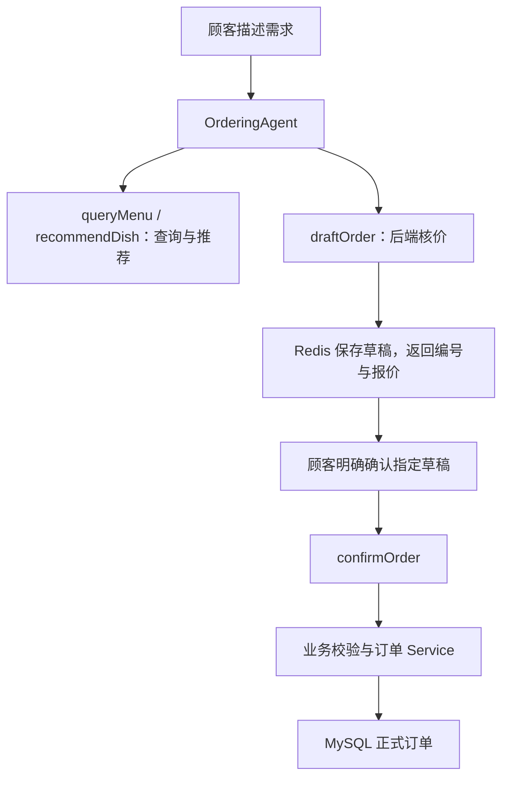

# 智能点餐系统 · V2 Agent

基于 **Java 17、Spring Boot、LangChain4j 和 DeepSeek** 的智能点餐项目。顾客用自然语言描述口味、人数和预算，系统检索菜品、生成候选搭配，由后端核算草稿报价，再经过用户明确确认创建正式订单。

项目保留 V1 的菜单、推荐、订单和反馈接口，V2 在现有 Service 之上增加工具调用与草稿确认流程。

> **当前进度（2026-10-20）**：V2 核心点餐闭环已完成主要 HTTP、模型与数据库联调；M2 已接入短期记忆、滑动续期、同会话并发拒绝与实例失效提示。注册用户长期画像已完成本人管理接口、Agent 默认口味读取及待确认候选工具；候选生成不会直接保存画像。下一步接入结构化候选响应与确认保存衔接，随后完善容量边界、流式响应和 Agent 前端。验收范围见[会话验证记录](docs/m2-memory-verification.md)和[长期画像验证记录](docs/m2-preference-verification.md)，不代表整个 M1/M2 计划已全部完成。

## 技术栈

版本以 [pom.xml](pom.xml) 和 [应用配置](src/main/resources/application.yml) 为准。

| 层次 | 当前选型 | 用途 |
| --- | --- | --- |
| 语言与构建 | Java 17、Maven Wrapper | 后端开发与构建 |
| Web 框架 | Spring Boot 4.0.8、Spring MVC | REST 接口、参数校验、统一响应 |
| 数据访问 | MyBatis Spring Boot Starter 4.0.1、MySQL | 菜品、订单、用户、长期口味画像、推荐记录与反馈持久化 |
| 缓存与临时状态 | Redis、Spring Data Redis、Lua | 用户令牌、订单草稿、会话归属与实例元数据、原子校验及续期 |
| Agent 编排与记忆 | LangChain4j 1.19.0；Spring Boot 4 Starter 1.19.0-beta29 | AI Services、工具调用、`@MemoryId` 与窗口记忆 |
| 本地生命周期管理 | Spring `@Scheduled`、`ConcurrentHashMap` | 同会话并发拒绝、使用状态跟踪与空闲过期记忆清理 |
| 对话模型 | DeepSeek `deepseek-chat` | 意图分析、推荐理由、工具选择与回复 |
| 向量化模型 | BGE-M3（硅基流动 `Pro/BAAI/bge-m3`） | 菜品文本与查询向量化 |
| 向量检索 | Qdrant；LangChain4j Qdrant 模块 1.19.0-beta29 | 语义召回、辣度与分类等元数据过滤 |
| 外部数据 | 和风天气 API | 推荐 Service 的天气上下文，失败时跳过 |
| 对象映射与校验 | MapStruct 1.6.3、Lombok、Jakarta Validation | DTO 映射、参数约束 |
| 前端 | 原生 HTML / CSS / JavaScript | V1 用户端页面、商户界面原型 |

## 已实现的功能

### V1：基础点餐与检索推荐

- **用户与游客**：手机号识别注册用户，签发 Redis 令牌；游客可以查看菜单、获取推荐和创建订单。
- **菜单管理**：商户维护菜品信息和上下架状态，支持菜品向量同步及全量重建。
- **RAG 推荐**：偏好分析 → 向量召回与元数据过滤 → 数据库核对在售菜品 → 候选排序与预算筛选 → 结合天气生成推荐理由。
- **反馈重排**：V1 推荐接口在提供有效用户身份时，可结合该用户的历史菜品评分调整候选顺序。
- **订单与反馈**：创建订单、保存明细价格快照、分页查询历史订单、提交菜品反馈。
- **状态与鉴权**：订单支持 `pending → paid / cancelled` 状态流转；用户信息、历史订单等受保护接口校验令牌与归属，商户接口使用独立令牌。当前没有接入真实支付。

### V2：工具调用与草稿确认

入口为 `POST /agent/chat`，由 `OrderingAgent` 调用 `DishTools` 中的五个工具；其中长期口味候选属于 M2：

| 工具 | 职责 | 返回结果 |
| --- | --- | --- |
| `queryMenu` | 查询当前在售菜单 | 菜品编号、名称、价格、分类与简介 |
| `recommendDish` | 根据偏好、人数与可选预算获取候选菜品 | 候选菜、单价和推荐理由 |
| `draftOrder` | 按菜品编号、数量和可选预算试算，并保存 Redis 草稿 | 明细、单价、小计、总额、超预算标记、草稿编号和有效期 |
| `confirmOrder` | 验证明确确认与草稿归属，调用订单 Service | 正式订单编号、状态、金额与明细，或业务失败原因 |
| `proposeUserPreference` | 整理待确认的长期口味，校验并保留未修改的画像字段 | 候选、状态与后续指引；不直接保存画像 |

推荐阶段的预算筛选目前是**候选菜品单价不高于预算**；组合总价由 `draftOrder` 根据选定数量与真实菜价，使用 `BigDecimal` 核算。超预算草稿可以返回给用户查看，但确认阶段会拒绝下单。

推荐工具描述、内层推荐模型和外层 Agent 已统一输出规则：推荐阶段展示候选菜品及单价；用户要求不试算时，不生成草稿、不自行汇总组合金额或给出整单预算结论。真实模型回归的两个样例已遵守报价边界；指定推荐数量仍可能出现偏差，详见长期画像验证记录。



确认流程包含以下约束：

- **后端提供身份**：游客归属来自 HTTP Session；注册用户归属来自已解析的 `X-User-Token`。
- **明确确认目标**：请求中的 `confirmedDraftId` 经后端上下文传递，必须与工具参数 `draftId` 一致。缺少确认或编号不一致时停止下单。
- **草稿有效期**：默认保存 15 分钟；确认新订单前检查归属、期限、预算、当前在售状态和菜品价格。
- **价格一致性**：创建订单时再次校验草稿单价，按本次查询的价格计算金额并保存明细快照。价格变化后需要重新试算、重新确认。
- **重复提交处理**：按 `draftId` 查找已有订单并校验归属；并发创建遇到唯一键冲突时查询并返回已有订单，依赖数据库的 `orders.draft_id` 唯一索引。
- **失败结果**：未确认、编号不一致、超预算、菜品下架、草稿失效或归属不符时，返回业务原因与后续处理建议。

### M2：短期会话记忆与生命周期

- **会话编号**：首次请求不传 `conversationId`，后端生成 UUID；后续请求携带返回的编号，继续同一段聊天。同一身份可开启多段独立聊天。
- **会话归属与实例**：Redis 的 `chat:conversation:<conversationId>` 保存 `ownerKey`、`instanceId` JSON。复用编号前检查归属；编号不存在或过期返回 HTTP 404，归属不一致返回 HTTP 403。
- **聊天上下文**：`@MemoryId` 将会话编号交给 `chatMemoryProvider`，每段聊天使用独立的 `MessageWindowChatMemory`，最多保留 20 条消息，包含系统和工具消息。
- **实例失效提示**：每次应用创建会话 Service 实例时生成一个实例编号。本人会话的编号与当前实例不同，返回 HTTP 409 和“对话上下文已失效，请开启新对话”；其他身份优先返回 403。旧格式纯 ownerKey 记录也会被拒绝，不自动恢复旧聊天。
- **存储边界**：聊天内容保存在当前 Java 进程内，Redis 保存会话元数据；重启仍会丢失本机聊天上下文，实例校验只识别失效，不恢复消息。尚未支持多实例共享聊天记忆或完整历史归档。
- **有效期**：`auth.conversation-ttl-minutes` 默认 30 分钟；归属与实例校验通过后，Lua 在同一次执行中刷新 TTL。过期、越权和实例失效请求不续期、不自动重建旧编号。
- **同会话并发**：当前单实例中，同一编号同时只允许一条消息进入 Agent，其余返回 HTTP 409，不写入模型记忆；不同会话可同时处理。忙碌判断位于续期之后，因此忙碌请求可能已刷新 TTL。
- **清理机制**：请求开始时登记使用计数，并再次检查 Redis 会话存在；在 `finally` 中归还计数。定时任务每轮结束后等待 60 秒，清理计数为零且会话已不存在的记忆，同时移除本地跟踪记录。
- **调用与故障保护**：正在执行的调用结束后再清理；Redis 检查失败时保留记录，后续重试。使用计数和清理通过同一编号的 `compute` 操作协调。

聊天记忆不代替订单报价、身份或本次确认授权。跨轮确认正式订单仍须提交 `confirmedDraftId`，后端继续检查草稿、归属、预算和菜价。

### M2：长期口味画像与待确认候选

- **本人画像管理**：MySQL `user_preference` 每个用户最多一条画像，保存 `spicyLevel`、最多 200 字的 `preferenceText` 和创建、更新时间；提供查看、整份替换保存和删除接口。
- **可信身份**：用户编号由 `X-User-Token` 解析；Controller 将用户编号与原画像通过 `InvocationParameters` 传给工具，模型只提供口味字段。游客不能管理注册用户画像。
- **默认口味**：每轮聊天读取当前画像，仅将两个口味字段整理为 JSON，通过 `@V("profileContext")` 注入提示词。本轮明确要求优先于普通长期偏好，临时人数、预算和口味不会自动持久化。
- **空值语义**：没有画像时传入 `{}`；辣度 `null` 表示未知，`none` 表示明确偏好不辣。画像 PUT 为整份替换，字段省略或传 `null` 都会清空对应值，删除画像可重复执行。
- **候选生成**：`proposeUserPreference` 仅处理长期口味候选；未传的工具参数保留原字段，补充说明传入更新后的完整文本。主动执行 Bean Validation，空白、无有效输入或超长文本返回 `INVALID_ARGUMENTS`，游客返回 `LOGIN_REQUIRED`。
- **确认边界**：工具成功表示候选已生成，尚未保存。当前聊天 HTTP 响应仍只有 `conversationId` 和 `reply`；独立画像 PUT 已可用，从工具执行结果提取结构化候选、展示确认操作并衔接保存是下一步工作。

本人画像接口通过 24 项真实 HTTP 与数据库检查；候选工具通过 17 项直接调用与 7 项真实 HTTP 行为检查。分阶段结果与范围见[长期画像验证记录](docs/m2-preference-verification.md)。

## 当前边界与后续计划

| 项目 | 当前状态 |
| --- | --- |
| Agent 四个点餐工具与确认流程 | 核心闭环及主要拒绝、身份、重试、并发场景已联调；另已新增 M2 口味候选工具，完整故障恢复与 V1 回归待补齐 |
| 跨请求聊天记忆 | 已接入；多轮记忆、游客与两个注册用户之间的隔离、同用户换 token 续聊已验证 |
| 会话过期与本机清理 | 已实现滑动有效期、定时清理和调用中保护；已有真实 HTTP 与受控程序分阶段验证 |
| 自动续期与同会话并发消息 | Lua 原子校验及续期已实现；单实例同会话忙碌时明确拒绝，不同会话可并行 |
| 重启后上下文失效提示 | 已实现实例编号检查和旧格式拒绝；通过实例切换模拟与 HTTP 检查，未执行真实进程重启演练 |
| 长期口味画像 | 本地表、本人画像 CRUD、Agent 读取和候选生成已实现并分阶段验证；聊天候选的结构化响应与确认保存衔接待做 |
| SSE / 流式响应 | 尚未接入；当前返回完整的 `ApiResponse<AgentChatResponse>` |
| Agent 前端 | 尚未接入；现有用户端仍调用 V1 推荐、下单接口 |
| Agent 个性化推荐 | 长期口味已作为默认上下文；推荐工具仍未透传登录用户身份参与历史评分重排 |
| 推荐输出规范 | 报价边界的两个真实样例回归通过；请求 2～3 道菜时仍出现列出 4 道的数量偏差，待优化 |
| 天气工具 | 天气由推荐 Service 内部调用，尚未封装为独立 Agent 工具 |
| 商户页面 | 仓库根目录提供界面原型，尚未接入后端 |
| 支付、取消、历史查询工具 | Agent 尚未提供这些工具；订单管理接口与真实支付接入是不同能力 |

后续任务见 [项目待办](docs/TODO.md)，阶段规划见 [V2 需求文档](docs/v2-requirements.md)。

## 主要接口

| 方法 | 路径 | 说明 | 身份要求 |
| --- | --- | --- | --- |
| POST | `/agent/chat` | V2 自然语言点餐与工具调用 | 支持游客；注册用户传令牌 |
| GET | `/dishes`、`/dishes/{dishNumber}` | 菜单列表、菜品详情 | 公开 |
| POST | `/recommendations` | V1 智能推荐 | 支持游客；个性化推荐需用户身份 |
| POST | `/orders` | V1 创建订单 | 公开；传入 userId 时检查用户存在及状态 |
| GET | `/orders/{userId}` | 分页查询历史订单 | 用户令牌与归属校验 |
| POST | `/feedback` | 提交菜品反馈 | 当前公开 |
| POST | `/users/identify` | 手机号识别并签发令牌 | 公开 |
| GET | `/users/{userId}` | 用户信息 | 用户令牌与归属校验 |
| GET | `/users/me/preference` | 查看本人长期口味，无记录时返回 `data: null` | 注册用户令牌 |
| PUT | `/users/me/preference` | 整份保存或替换本人画像，返回持久化后的画像 | 注册用户令牌 |
| DELETE | `/users/me/preference` | 删除本人画像，重复删除可成功结束 | 注册用户令牌 |
| POST | `/admin/dishes` | 新增菜品 | 商户令牌 |
| PUT | `/admin/dishes/{dishNumber}` | 更新菜品 | 商户令牌 |
| PUT | `/admin/dishes/{dishNumber}/status` | 菜品上下架 | 商户令牌 |
| POST | `/admin/dishes/vector/resync` | 全量重建菜品向量 | 商户令牌 |
| PATCH | `/admin/orders` | 更新订单状态 | 商户令牌 |

用户令牌通过 `X-User-Token` 传递，商户令牌通过 `X-Admin-Token` 传递。用户令牌默认有效期为 2 小时。

### Agent 请求示例

请求头使用 `Content-Type: application/json`。首次开启聊天时不传 `conversationId`，普通聊天不传 `confirmedDraftId`：

```json
{
  "message": "两个人吃饭，想吃清淡的，预算100元，请推荐一套搭配并试算。"
}
```

成功响应的 `data` 包含会话编号与回复文本，结构如下：

```json
{
  "code": 0,
  "msg": "success",
  "data": {
    "conversationId": "<后端返回的实际conversationId>",
    "reply": "<模型回复文本>"
  }
}
```

继续聊天时带上真实会话编号：

```json
{
  "conversationId": "<实际conversationId>",
  "message": "请复述我刚才说的人数、预算和口味，先不要下单。"
}
```

查看草稿与报价后，由用户明确确认，再发送：

```json
{
  "conversationId": "<实际conversationId>",
  "message": "确认提交草稿 <实际draftId>",
  "confirmedDraftId": "<实际draftId>"
}
```

将草稿占位符替换成同一个真实草稿编号，`conversationId` 使用该段聊天返回的编号。记忆能提供上下文，`confirmedDraftId` 仍用于后端校验本次确认目标。游客跨轮请求需要保持同一 Session Cookie，注册用户需要使用同一用户的有效令牌。修改方案生成新草稿后，必须重新确认新编号。

外层 `code: 0` 表示聊天请求成功，是否正式下单仍以工具返回的真实订单为准。会话归属、过期和入口参数校验失败发生在模型调用前，会直接返回相应 HTTP 状态及错误码。

### 本人画像请求示例

登录后使用 `X-User-Token`，向 `PUT /users/me/preference` 提交整份画像：

```json
{
  "spicyLevel": "none",
  "preferenceText": "少油，喜欢菌菇"
}
```

请求体不传用户编号。`spicyLevel` 可为 `none`、`mild`、`medium`、`high` 或 `null`。PUT 是整份替换：只修改一项时也应带上需要保留的另一项；提交 `{}` 会清空两个字段，但保留画像记录。聊天中的候选工具不执行这次写入。

## 本轮验证

- 核心点餐：草稿核价、确认下单、重复确认、超预算与价格变化拒绝、确认目标匹配及主要身份场景已有联调结果；同一草稿并发 HTTP 请求返回同一订单，数据库为一笔主订单和一套明细。
- 短期记忆：真实模型多轮记忆、同一游客的新旧聊天隔离、游客与两个注册用户会话的双向越权拒绝及各自记忆读取均通过。
- 过期与清理：真实 HTTP 过期后返回 404；另用实际 Controller、Service、LangChain4j 记忆和真实 Redis 完成 10 项临时验证，覆盖空闲清理、调用中保护、竞争和故障重试。
- 滑动续期：8 项真实 HTTP、模型与 Redis 检查通过，包含反复续期、越权不续期及过期不重建。
- 同会话并发：8 项受控检查与 3 项真实 HTTP 检查通过；受控 12 条同会话请求仅一条进入模型，其余 11 条为 409，正常与异常结束后均可再发送。
- 注册用户隔离：8 项真实链路检查通过，包含双向越权、不带或无效 token 拒绝，以及同一用户换 token 后读取原会话。
- 实例失效：6 项实际 Service 模拟与 7 项真实 HTTP 检查通过，覆盖本人旧实例 409、他人优先 403、旧格式缓存、过期不重建及重新开聊。
- 本人画像接口：24 项真实 HTTP 与数据库检查通过，覆盖保存、修改、清空、删除、长度边界、身份隔离及令牌校验。
- 画像上下文：完成 15 项画像相关检查；两次真实推荐的辣度与数据库一致，发现的推荐阶段组合报价问题随后通过两个样例回归，候选数量偏差仍保留为待办。
- 候选生成：17 项工具直接调用与 7 项真实 HTTP 行为检查通过，覆盖空参数、字段保留、200/201 字边界、游客、候选改写及未确认不持久化。
- 提交前检查：2026-10-20 执行 `./mvnw test`，仓库现有 2 项测试通过（请求校验与 Spring 上下文启动），文档本地链接检查通过。

慢模型、Redis 故障和实例切换采用可控模拟，临时验证程序及产物已删除；画像测试恢复原记录并清理本轮 token 与 Redis 会话。各轮针对当时实现验收，未对最新代码执行整套自动化业务回归，也不是持续集成记录；范围与复测步骤见[会话验证记录](docs/m2-memory-verification.md)和[长期画像验证记录](docs/m2-preference-verification.md)。

## 本地运行

### 1. 准备依赖与数据库

- JDK 17；项目提供 Maven Wrapper。
- MySQL：默认连接 `localhost:3306/smart_ordering`。
- Redis：默认 `localhost:6379`。
- Qdrant：应用通过 gRPC 连接 `localhost:6334`，集合名为 `dish`；需准备与当前向量化模型维度匹配的集合，并同步菜品向量。

[建表文档](docs/智能点餐系统数据库建表语句.md) 是早期结构参考，仓库暂未提供覆盖当前版本的完整初始化与迁移脚本。新环境需结合 Mapper 核对数据库结构，尤其是：

- `dish.spicy_level` 和 `user_dish_feedback` 等推荐依赖。
- `orders.draft_id`、`orders.draft_owner_key`，以及 `draft_id` 唯一索引；两列需兼容不带草稿信息的 V1 订单。
- `user_preference`：新环境执行[长期画像建表 SQL](docs/智能点餐系统数据库建表语句.md#m2-用户长期画像新表-sql)，已有表先核对结构。
- 启动时的 `FeedbackDataSeeder` 会在反馈表为空时写入演示评分，相关演示用户与菜品编号需事先存在。

### 2. 配置环境变量

| 环境变量 | 用途 |
| --- | --- |
| `SPRING_DATASOURCE_USERNAME` | MySQL 用户名，默认 `root` |
| `SPRING_DATASOURCE_PASSWORD` | MySQL 密码 |
| `DEEPSEEK_API_KEY` | DeepSeek 对话模型密钥 |
| `BGE_M3_API_KEY` | 硅基流动 BGE-M3 向量化模型密钥 |
| `QWEATHER_API_KEY` | 和风天气密钥 |
| `QWEATHER_BASE_URL` | 和风天气控制台提供的 API Host，包含 `https://` |
| `ADMIN_TOKEN` | 商户接口令牌 |

Windows PowerShell 示例（替换占位符后执行）：

```powershell
$env:SPRING_DATASOURCE_USERNAME = "root"
$env:SPRING_DATASOURCE_PASSWORD = "<数据库密码>"
$env:DEEPSEEK_API_KEY = "<DeepSeek密钥>"
$env:BGE_M3_API_KEY = "<硅基流动密钥>"
$env:QWEATHER_API_KEY = "<和风天气密钥>"
$env:QWEATHER_BASE_URL = "https://<你的和风天气API Host>"
$env:ADMIN_TOKEN = "<商户令牌>"

.\mvnw.cmd spring-boot:run
```

macOS / Linux 设置相同环境变量后，使用 `./mvnw spring-boot:run` 启动。

### 3. 访问与联调

- V1 用户端：[http://localhost:8080/user-frontend/index.html](http://localhost:8080/user-frontend/index.html)。
- V2 Agent：通过 HTTP 客户端访问 `POST http://localhost:8080/agent/chat`，请求格式见上文。
- 商户原型：[merchant_ui.html](merchant_ui.html) 位于仓库根目录，可本地打开查看；目前未作为 Spring Boot 静态页面发布，也未接入真实商户接口。

## 目录结构

```text
smart-ordering-system
├── docs/                          需求、阶段计划、业务建模与数据库参考
├── src/main/java/com/luwei/ordering
│   ├── agent/                     Agent 提示词与 DishTools 工具
│   ├── bootstrap/                 演示反馈数据初始化
│   ├── common/                    枚举、异常、统一响应、类型处理器
│   ├── config/                    AI Services、Web 配置与拦截器
│   ├── controller/                Agent、用户端与商户端接口
│   ├── converter/                 实体与 DTO 转换
│   ├── dto/                       请求、工具结果、草稿快照与订单响应
│   ├── entity/                    数据库实体
│   ├── mapper/                    MyBatis Mapper
│   ├── model/conversation/        Redis 会话归属及实例元数据
│   └── service/                   检索推荐、草稿、订单、身份与会话记忆管理
├── src/main/resources
│   ├── application.yml            服务连接与模型配置
│   ├── mapper/                    Mapper XML
│   └── static/user-frontend/      V1 用户端页面
├── src/test/                      测试代码
└── merchant_ui.html               商户界面原型
```

## 项目文档

- [V1 需求与验收标准](docs/requirements.md)
- [V2 Agent 阶段规划](docs/v2-requirements.md)
- [会话记忆与流式聊天待办](docs/TODO.md)
- [会话记忆与生命周期验证记录（更新至 2026-10-20）](docs/m2-memory-verification.md)
- [长期口味画像与候选生成验证记录](docs/m2-preference-verification.md)
- [业务建模](docs/智能点餐系统业务建模.md)
- [数据库设计思路](docs/智能点餐系统数据库设计思路.md)
- [早期建表语句参考](docs/智能点餐系统数据库建表语句.md)
