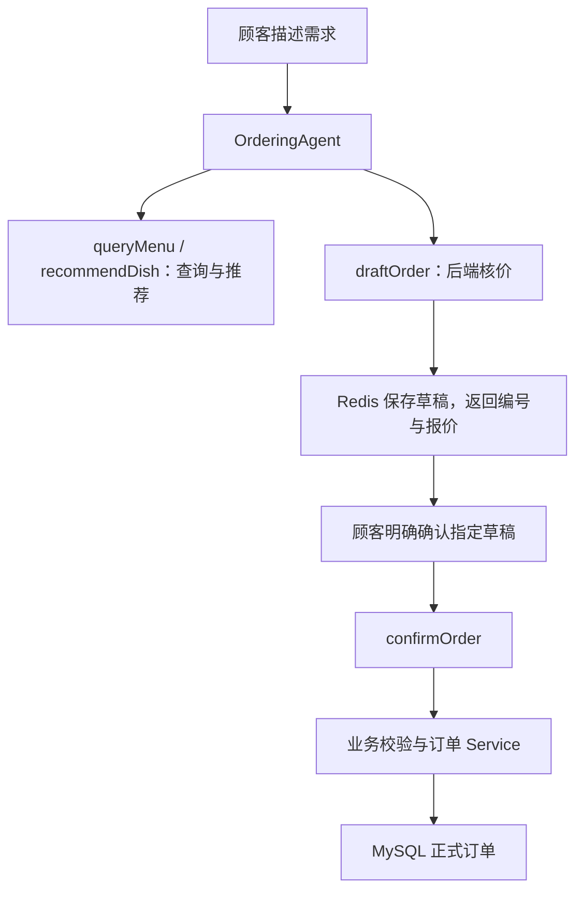

# 智能点餐系统 · V2 Agent

基于 **Java 17、Spring Boot、LangChain4j 和 DeepSeek** 的智能点餐项目。顾客用自然语言描述口味、人数和预算，系统检索菜品、生成候选搭配，由后端核算草稿报价，再经过用户明确确认创建正式订单。

项目保留 V1 的菜单、推荐、订单和反馈接口，V2 在现有 Service 之上增加工具调用与草稿确认流程。

> **当前进度（2026-10-13）**：V2 四个工具及草稿确认后端流程已实现，已完成编译与工具层模拟检查；真实模型、HTTP 接口和数据库的完整确认链路待联调验收。会话记忆、流式响应和 Agent 前端仍在计划中。

## 技术栈

版本以 [pom.xml](pom.xml) 和 [应用配置](src/main/resources/application.yml) 为准。

| 层次 | 当前选型 | 用途 |
| --- | --- | --- |
| 语言与构建 | Java 17、Maven Wrapper | 后端开发与构建 |
| Web 框架 | Spring Boot 4.0.8、Spring MVC | REST 接口、参数校验、统一响应 |
| 数据访问 | MyBatis Spring Boot Starter 4.0.1、MySQL | 菜品、订单、用户、推荐记录与反馈持久化 |
| 缓存与临时状态 | Redis、Spring Data Redis | 用户令牌、订单草稿及过期管理 |
| Agent 编排 | LangChain4j 1.19.0；Spring Boot 4 Starter 1.19.0-beta29 | AI Services、工具调用、调用上下文传递 |
| 对话模型 | DeepSeek `deepseek-chat` | 意图分析、推荐理由、工具选择与回复 |
| 向量化模型 | BGE-M3（硅基流动 `Pro/BAAI/bge-m3`） | 菜品文本与查询向量化 |
| 向量检索 | Qdrant；LangChain4j Qdrant 模块 1.19.0-beta29 | 语义召回、辣度与分类等元数据过滤 |
| 外部数据 | 和风天气 API | 推荐 Service 的天气上下文，失败时跳过 |
| 对象映射与校验 | MapStruct 1.6.3、Lombok、Jakarta Validation | DTO 映射、参数约束 |
| 前端 | 原生 HTML / CSS / JavaScript | V1 用户端页面、商户界面原型 |

## 已实现的功能

### V1：基础点餐与检索推荐

- **用户与游客**：手机号识别注册用户，签发 Redis 令牌；游客可以查看菜单、获取推荐和创建订单。
- **菜单管理**：商户维护菜品信息和上下架状态，支持菜品向量同步及全量重建。
- **RAG 推荐**：偏好分析 → 向量召回与元数据过滤 → 数据库核对在售菜品 → 候选排序与预算筛选 → 结合天气生成推荐理由。
- **反馈重排**：V1 推荐接口在提供有效用户身份时，可结合该用户的历史菜品评分调整候选顺序。
- **订单与反馈**：创建订单、保存明细价格快照、分页查询历史订单、提交菜品反馈。
- **状态与鉴权**：订单支持 `pending → paid / cancelled` 状态流转；用户信息、历史订单等受保护接口校验令牌与归属，商户接口使用独立令牌。当前没有接入真实支付。

### V2：工具调用与草稿确认

入口为 `POST /agent/chat`，由 `OrderingAgent` 调用 `DishTools` 中的四个工具：

| 工具 | 职责 | 返回结果 |
| --- | --- | --- |
| `queryMenu` | 查询当前在售菜单 | 菜品编号、名称、价格、分类与简介 |
| `recommendDish` | 根据偏好、人数与可选预算获取候选菜品 | 候选菜、单价和推荐理由 |
| `draftOrder` | 按菜品编号、数量和可选预算试算，并保存 Redis 草稿 | 明细、单价、小计、总额、超预算标记、草稿编号和有效期 |
| `confirmOrder` | 验证明确确认与草稿归属，调用订单 Service | 正式订单编号、状态、金额与明细，或业务失败原因 |

推荐阶段的预算筛选目前是**候选菜品单价不高于预算**；组合总价由 `draftOrder` 根据选定数量与真实菜价，使用 `BigDecimal` 核算。超预算草稿可以返回给用户查看，但确认阶段会拒绝下单。



确认流程包含以下约束：

- **后端提供身份**：游客归属来自 HTTP Session；注册用户归属来自已解析的 `X-User-Token`。
- **明确确认目标**：请求中的 `confirmedDraftId` 经后端上下文传递，必须与工具参数 `draftId` 一致。缺少确认或编号不一致时停止下单。
- **草稿有效期**：默认保存 15 分钟；确认新订单前检查归属、期限、预算、当前在售状态和菜品价格。
- **价格一致性**：创建订单时再次校验草稿单价，按本次查询的价格计算金额并保存明细快照。价格变化后需要重新试算、重新确认。
- **重复提交处理**：按 `draftId` 查找已有订单并校验归属；并发创建遇到唯一键冲突时查询并返回已有订单，依赖数据库的 `orders.draft_id` 唯一索引。
- **失败结果**：未确认、编号不一致、超预算、菜品下架、草稿失效或归属不符时，返回业务原因与后续处理建议。

## 当前边界与后续计划

| 项目 | 当前状态 |
| --- | --- |
| Agent 后端四个工具与确认流程 | 代码已实现，完整确认链路待联调验收 |
| 跨请求聊天记忆 | 尚未接入；当前确认请求需明确带上草稿编号 |
| SSE / 流式响应 | 尚未接入；当前返回完整的 `ApiResponse<String>` |
| Agent 前端 | 尚未接入；现有用户端仍调用 V1 推荐、下单接口 |
| Agent 个性化推荐 | 当前走通用推荐，尚未透传登录用户历史反馈 |
| 天气工具 | 天气由推荐 Service 内部调用，尚未封装为独立 Agent 工具 |
| 商户页面 | 仓库根目录提供界面原型，尚未接入后端 |
| 支付、取消、历史查询工具 | Agent 尚未提供这些工具；订单管理接口与真实支付接入是不同能力 |

后续任务见 [项目待办](docs/TODO.md)，阶段规划见 [V2 需求文档](docs/v2-requirements.md)。

## 主要接口

| 方法 | 路径 | 说明 | 身份要求 |
| --- | --- | --- | --- |
| POST | `/agent/chat` | V2 自然语言点餐与工具调用 | 支持游客；注册用户传令牌 |
| GET | `/dishes`、`/dishes/{dishNumber}` | 菜单列表、菜品详情 | 公开 |
| POST | `/recommendations` | V1 智能推荐 | 支持游客；个性化推荐需用户身份 |
| POST | `/orders` | V1 创建订单 | 公开；传入 userId 时检查用户存在及状态 |
| GET | `/orders/{userId}` | 分页查询历史订单 | 用户令牌与归属校验 |
| POST | `/feedback` | 提交菜品反馈 | 当前公开 |
| POST | `/users/identify` | 手机号识别并签发令牌 | 公开 |
| GET | `/users/{userId}` | 用户信息 | 用户令牌与归属校验 |
| POST | `/admin/dishes` | 新增菜品 | 商户令牌 |
| PUT | `/admin/dishes/{dishNumber}` | 更新菜品 | 商户令牌 |
| PUT | `/admin/dishes/{dishNumber}/status` | 菜品上下架 | 商户令牌 |
| POST | `/admin/dishes/vector/resync` | 全量重建菜品向量 | 商户令牌 |
| PATCH | `/admin/orders` | 更新订单状态 | 商户令牌 |

用户令牌通过 `X-User-Token` 传递，商户令牌通过 `X-Admin-Token` 传递。用户令牌默认有效期为 2 小时。

### Agent 请求示例

请求头使用 `Content-Type: application/json`。普通聊天不传 `confirmedDraftId`：

```json
{
  "message": "两个人吃饭，想吃清淡的，预算100元，请推荐一套搭配并试算。"
}
```

查看工具返回的草稿与报价后，由用户明确确认，再发送：

```json
{
  "message": "确认提交草稿 <实际draftId>",
  "confirmedDraftId": "<实际draftId>"
}
```

将两处占位符替换成同一个真实草稿编号。当前尚无跨请求聊天记忆，`message` 中也需要包含编号；`confirmedDraftId` 用于后端校验确认目标。游客在试算和确认之间需要保持同一 Session Cookie，注册用户需要使用同一用户的有效令牌。修改方案生成新草稿后，必须重新确认新编号。

## 本地运行

### 1. 准备依赖与数据库

- JDK 17；项目提供 Maven Wrapper。
- MySQL：默认连接 `localhost:3306/smart_ordering`。
- Redis：默认 `localhost:6379`。
- Qdrant：应用通过 gRPC 连接 `localhost:6334`，集合名为 `dish`；需准备与当前向量化模型维度匹配的集合，并同步菜品向量。

[建表文档](docs/智能点餐系统数据库建表语句.md) 是早期结构参考，仓库暂未提供覆盖当前版本的完整初始化与迁移脚本。新环境需结合 Mapper 核对数据库结构，尤其是：

- `dish.spicy_level` 和 `user_dish_feedback` 等推荐依赖。
- `orders.draft_id`、`orders.draft_owner_key`，以及 `draft_id` 唯一索引；两列需兼容不带草稿信息的 V1 订单。
- 启动时的 `FeedbackDataSeeder` 会在反馈表为空时写入演示评分，相关演示用户与菜品编号需事先存在。

### 2. 配置环境变量

| 环境变量 | 用途 |
| --- | --- |
| `SPRING_DATASOURCE_USERNAME` | MySQL 用户名，默认 `root` |
| `SPRING_DATASOURCE_PASSWORD` | MySQL 密码 |
| `DEEPSEEK_API_KEY` | DeepSeek 对话模型密钥 |
| `BGE_M3_API_KEY` | 硅基流动 BGE-M3 向量化模型密钥 |
| `QWEATHER_API_KEY` | 和风天气密钥 |
| `QWEATHER_BASE_URL` | 和风天气控制台提供的 API Host，包含 `https://` |
| `ADMIN_TOKEN` | 商户接口令牌 |

Windows PowerShell 示例（替换占位符后执行）：

```powershell
$env:SPRING_DATASOURCE_USERNAME = "root"
$env:SPRING_DATASOURCE_PASSWORD = "<数据库密码>"
$env:DEEPSEEK_API_KEY = "<DeepSeek密钥>"
$env:BGE_M3_API_KEY = "<硅基流动密钥>"
$env:QWEATHER_API_KEY = "<和风天气密钥>"
$env:QWEATHER_BASE_URL = "https://<你的和风天气API Host>"
$env:ADMIN_TOKEN = "<商户令牌>"

.\mvnw.cmd spring-boot:run
```

macOS / Linux 设置相同环境变量后，使用 `./mvnw spring-boot:run` 启动。

### 3. 访问与联调

- V1 用户端：[http://localhost:8080/user-frontend/index.html](http://localhost:8080/user-frontend/index.html)。
- V2 Agent：通过 HTTP 客户端访问 `POST http://localhost:8080/agent/chat`，请求格式见上文。
- 商户原型：[merchant_ui.html](merchant_ui.html) 位于仓库根目录，可本地打开查看；目前未作为 Spring Boot 静态页面发布，也未接入真实商户接口。

## 目录结构

```text
smart-ordering-system
├── docs/                          需求、阶段计划、业务建模与数据库参考
├── src/main/java/com/luwei/ordering
│   ├── agent/                     Agent 提示词与 DishTools 工具
│   ├── bootstrap/                 演示反馈数据初始化
│   ├── common/                    枚举、异常、统一响应、类型处理器
│   ├── config/                    AI Services、Web 配置与拦截器
│   ├── controller/                Agent、用户端与商户端接口
│   ├── converter/                 实体与 DTO 转换
│   ├── dto/                       请求、工具结果、草稿快照与订单响应
│   ├── entity/                    数据库实体
│   ├── mapper/                    MyBatis Mapper
│   └── service/                   检索推荐、草稿、订单与身份业务逻辑
├── src/main/resources
│   ├── application.yml            服务连接与模型配置
│   ├── mapper/                    Mapper XML
│   └── static/user-frontend/      V1 用户端页面
├── src/test/                      测试代码
└── merchant_ui.html               商户界面原型
```

## 项目文档

- [V1 需求与验收标准](docs/requirements.md)
- [V2 Agent 阶段规划](docs/v2-requirements.md)
- [会话记忆与流式聊天待办](docs/TODO.md)
- [业务建模](docs/智能点餐系统业务建模.md)
- [数据库设计思路](docs/智能点餐系统数据库设计思路.md)
- [早期建表语句参考](docs/智能点餐系统数据库建表语句.md)
