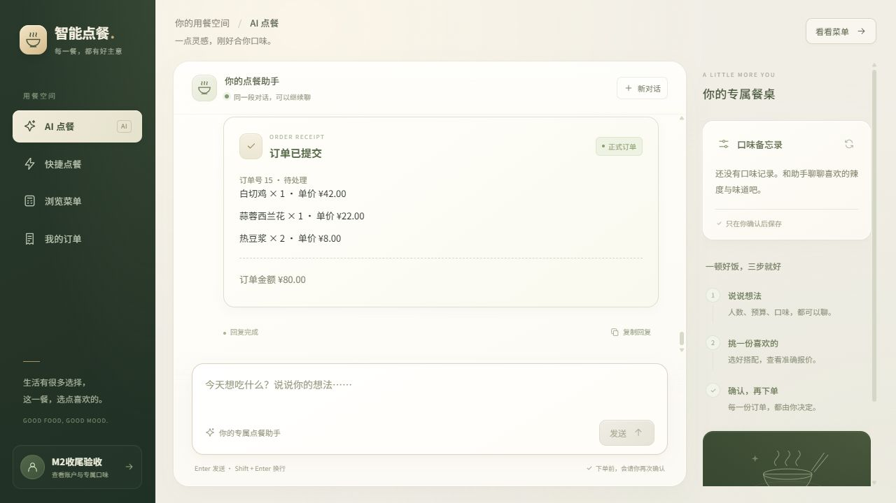
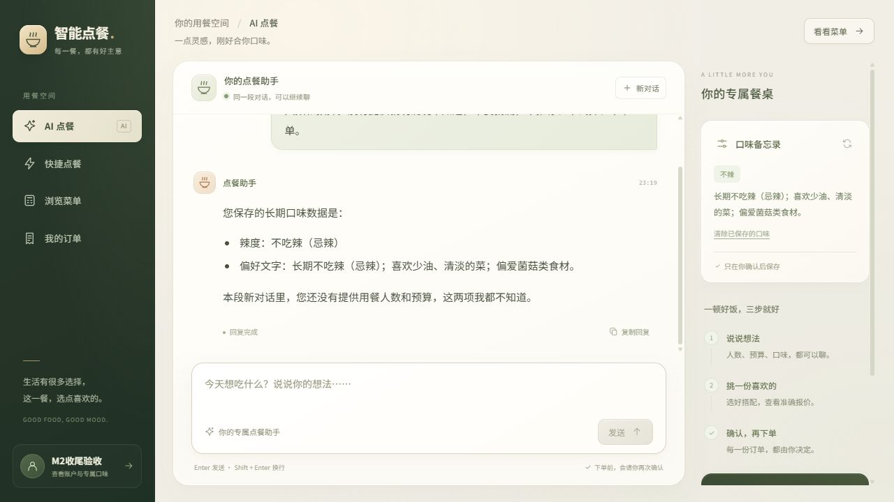

# M2 首版收尾：真实页面多轮点餐与长期画像

验证日期：2026-10-21。M2 首版核心范围的收尾验收完成；推荐候选数量偏差继续保留为后续优化，M1 故障恢复及全面 V1 回归不计入本次完成范围。

## 环境与方式

使用用户正在运行的 8080 Spring Boot、最新用户端页面、真实模型、Qdrant、Redis 与 MySQL。运行中的服务最初仍在读取旧静态资源，通过 Maven `resources:resources` 同步到构建目录后刷新页面，未修改前端源码或重启用户服务。

浏览器使用专用新建账号和独立聊天，所有推荐、试算、确认与画像操作均从真实页面发起。临时 JDBC/Redis 程序只用于记录基线、核对结果和清理本轮数据；未用直接 SQL 插入订单或画像来替代页面操作。

## 多轮点餐验收

| 步骤 | 操作 | 结果 |
| --- | --- | --- |
| 1 | 首轮提供 2 人、100 元、清淡不辣，要求仅记住本次需求 | 回复记住三项，未创建草稿、订单或画像 |
| 2 | 下一轮仅说“按刚才的人数、预算和口味推荐”，要求候选编号与单价，不试算 | 主要列表返回蒜蓉西兰花 12/22 元、清蒸鲈鱼 6/68 元、白切鸡 10/42 元，和真实菜单一致；未提供组合总价 |
| 3 | 清蒸鲈鱼 1 份、蒜蓉西兰花 1 份、热豆浆 1 份，沿用前文预算 | 草稿及报价卡显示 98 元、预算 100 元；尚无正式订单 |
| 4 | 只将热豆浆改为 2 份 | 新草稿为 106 元、预算仍为 100 元、`overBudget=true`；前端确认按钮禁用，原报价被新试算替代 |
| 5 | 将清蒸鲈鱼替换为白切鸡 1 份，保留西兰花 1 份、豆浆 2 份 | 最新草稿为 80 元、预算 100 元、未超预算；Redis 的单价、数量、小计及合计逐项核对通过 |
| 6 | 打开最新报价弹窗，再选择“再想想” | 弹窗金额及菜品与卡片一致；数据库仍无本次正式订单 |
| 7 | 重新打开弹窗，点击“确认提交订单” | 页面出现真实结构化回执；数据库仅有 1 笔专用账号订单和 3 条明细，订单号 15、金额 80 元、状态 pending，关联最新草稿与正确归属 |

正式订单明细：白切鸡 1 × 42 元、蒜蓉西兰花 1 × 22 元、热豆浆 2 × 8 元。数据库金额等于明细价格快照乘数量之和。旧草稿按钮在正式订单返回后均禁用。此下单不涉及真实支付。

## 长期画像验收

| 步骤 | 操作 | 结果 |
| --- | --- | --- |
| 1 | 在点餐对话中提出长期不吃辣、少油、喜欢菌菇，要求生成候选且不保存 | 页面提供待确认候选和保存按钮；MySQL 本人画像仍为空；人数、预算没有写入候选 |
| 2 | 点击“确认保存口味” | MySQL 新增本人画像，`spicy_level=none`；补充说明为长期不吃辣、少油清淡、偏爱菌菇；侧栏刷新，保存按钮禁用 |
| 3 | 点击“新对话”，只询问已保存口味，以及是否知道本段人数和预算 | 新会话正确复述长期口味，明确表示不知道本段人数和预算；Redis 记录为两段独立会话 |
| 4 | 打开清除确认框，选择“保留口味” | 侧栏及数据库画像保留 |
| 5 | 再次打开并点击“确认清除” | 侧栏变为空状态，MySQL 本人画像记录删除 |
| 6 | 同一会话下一轮询问本轮后台加载的画像，不将旧聊天当作持久化事实 | 回复当前没有已保存的长期口味，未生成新候选或操作订单；数据库仍只有原测试订单 |

## 实现说明

1. 页面向 `/agent/chat/stream` 发送消息。首次由后端生成编号，后续携带同一 `conversationId`；确认按钮只为用户核对的真实草稿附上 `confirmedDraftId`。
2. Controller 从有效 token 或 Session 确定身份，Redis 校验会话归属与实例编号；`@MemoryId` 让不同聊天使用独立的本机窗口记忆。新对话更换编号，临时人数和预算不自动写入长期画像。
3. Agent 调用查询、推荐和草稿工具，业务 Service 核算价格并保存草稿。正式创建订单仍经过明确确认、归属、预算、在售和价格校验。
4. SSE done 携带实际工具返回对象，前端用结构化报价和回执展示操作结果。口味候选同样来自工具对象，只有独立的本人画像 PUT 操作才保存。
5. 全局 4 个许可限制正在执行的聊天，默认 100 个独立许可限制本机缓存会话。请求结束不立即删除记忆；空闲且元数据已过期的会话才由定时任务清理并归还缓存名额。SSE 断连只结束输出，模型或工具结束后才归还在途许可及使用计数。

## 自动化与清理

- 前一收尾阶段已适配现有 Controller 测试初始化并重跑 Java 测试，32/32 通过，详见[容量记录](m2-capacity-verification.md)。本轮没有修改 Java 实现或新增持久测试。
- 前端升级后重新执行 `node --test src/test/frontend/agent-client.test.mjs`，18/18 通过；`agent.js`、`app.js` 的 Node 语法检查通过。
- 页面退出专用测试账号，清理测试订单及 3 条明细、账号，以及本轮 3 个草稿、2 个会话和 1 个令牌 Key。用户、订单、明细、画像、推荐记录和菜品反馈六张表的记录数全部恢复到测试前；既有用户画像保留。
- 截图和本记录保留为验收证据；临时检查源码、编译产物、状态清单、依赖清单和日志在检查结束后删除。用户 8080 服务继续运行，未执行 Git 提交或推送。

## 已知问题与范围

请求 2～3 道候选时，本次主要列表虽为 3 道，回复仍额外提及红烧肉、地三鲜两项备选。因此候选数量遵从性继续保持未完成，不能将本轮闭环通过写成数量问题已经修复。

本次证明真实页面的多轮调整、后端报价、明确下单与画像确认保存可连通，不代表所有模型输入都具有相同行为，也不是完整故障注入、所有设备检查或 M1/V1 全量回归。即时取消、断点续传、聊天历史、多实例共享记忆等范围保持原计划。
