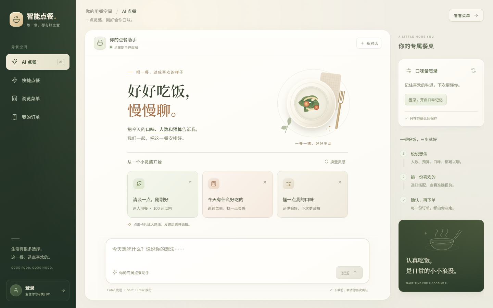

# M2 Agent 前端：实现、验证与讲解顺序

更新日期：2026-10-22。基于已有原生前端改造，采用深墨绿导航、奶油色画布和陶土色重点按钮：左侧导航、中间对话、右侧口味与用餐指引。第二轮细化采用衬线标题、陶瓷餐盘 SVG 插画、暖色卡片与分层柔光阴影，强化对比与主次；没有新增前端框架、外部字体请求或第三方运行依赖。

细节精修保留上述风格，新增消息时间与回复复制反馈，调整阅读字号、等待动画、触控与键盘焦点。报价卡突出菜品清单和总额，报价编号与有效期通过原生 `details` 按需展开；字数仅在输入时显示，临近 2000 字时强调提示。新报价与口味候选的按钮在回复完成并通过前端状态校验后启用。

## 如何打开

启动 Spring Boot 后访问 `http://localhost:8080/user-frontend/index.html`，默认进入「AI 点餐」。页面与接口同源，游客请求保留 Session Cookie，注册用户沿用现有 `X-User-Token`。

页面使用 ES Modules，请通过 HTTP 打开，不能依赖直接双击 HTML。导航中的「快捷点餐」保留原 V1 推荐及购物车，「浏览菜单」和「我的订单」继续可用。Agent 聊天页隐藏手动购物车栏，防止把两个下单流程混在一起。



[查看手机尺寸预览](images/agent-refined-mobile.png)

[查看聊天与报价卡细节](images/agent-detail-chat-desktop.png)（隔离界面验证数据，未提交真实订单）。

### 内容与页面统一（2026-10-22）

- AI 首页：调整标题、餐盘插画与灵感卡的间距和层次，新增“换些灵感”。两组本地场景循环切换，点击卡片只填入输入框，用户发送后才请求 AI；不改写订单或画像确认规则。
- 菜单：桌面三列、中屏两列、窄屏单列，分类使用原生线描 SVG；完整菜名独立显示，简介、单价和数量操作分层，选中状态跨筛选及推荐结果保持同步。
- 快捷点餐：改为说明与浅色表单并排，手机顺序排列；保留快捷口味、人数、预算、推荐结果横向浏览与收起恢复。
- 订单：共用安全转义后的卡片模板，菜品、数量、小计对齐，突出合计与状态；区分游客未登录与已登录暂无订单的提示。新增 `content.css` 承载非 AI 页样式。
- 浏览器验证：四页分别检查 1440×900、1366×768、1181×800、1024×768、768×1024、760×900、390×844、320×640，共 32 个页面/尺寸组合；未出现文档横向溢出、卡片操作区超宽或 AI 输入框超出视口。
- 交互验证：真实菜单读取、分类筛选和 `aria-pressed`、选择/增减数量/跨页同步、灵感换组与填入、窄屏口味面板及 Escape 均通过。隔离模拟 SSE 和推荐响应验证回复、结果收起恢复不重发请求；本地模拟订单验证明细、再来一单、游客评分登录入口及账号空态。没有调用真实订单、画像写入或评分接口；浏览器无脚本异常。
- 原有 18 项前端协议与确认规则测试通过，两个脚本语法检查和前端改动 `git diff --check` 通过。此轮未执行完整后端回归。

[菜单桌面预览](images/menu-content-desktop.png) · [菜单手机预览](images/menu-content-mobile.png) · [快捷点餐预览](images/quick-order-content-desktop.png)。菜单图来自当前在售数据；上文报价图仍为隔离测试数据。

### UI 改版复测（2026-10-21）

- 首轮真实服务联调：游客从界面发送一条介绍能力的消息，`POST /agent/chat/stream` 返回 200，收到完整回复；没有请求下单、试算或保存口味。
- 响应式：细节精修后复测 1440×900、1366×768、1280×800、1181×800、1024×768、768×1024、760×900、390×844、375×667、320×640，页面无横向溢出，输入框保持在视口内。短屏仅在消息区与右侧面板内部滚动。
- 交互：快捷问题填入并启用发送、输入框自动增高、新对话重置、菜单加载、四个页面切换、登录弹窗均通过；浏览器无脚本异常。
- 窄屏口味面板：复用同一组偏好控件，在原生 `dialog` 中显示；Esc 关闭并返回触发按钮，切回宽屏时恢复为右侧栏。
- 隔离界面：模拟 SSE 报价验证金额、桌面/手机确认弹窗与取消；模拟 HTTP 503 验证可读错误和继续输入。取消未发出确认请求，此项不代表真实订单写库验证。
- 细节交互：在隔离浏览器中验证复制成功、复制失败恢复、报价详情的键盘展开/收起、1800 字提示、Shift+Enter 不发送；复制及展开不会增加接口请求。剪贴板采用测试替身，未读取或改动系统剪贴板。
- 确认边界：隔离响应覆盖超预算、过期报价按钮禁用、恶意菜名作为文本显示；明确点击提交时仅携带当前报价编号。口味候选按钮在回复完成后可用，游客保存打开登录，暂不保存后禁用候选操作。未调用真实订单或画像写入接口。
- 保留的 18 项前端协议、安全格式化与确认规则测试全部通过。此次只改前端，未执行整套后端回归。

## 已接入的交互

- **聊天**：首次不传 conversationId，收到 meta 后保存编号供下一轮使用；同页切换保留对话，新对话或身份切换会清空页面聊天。刷新页面开启新对话，目前没有历史聊天列表。
- **流式回复**：fetch POST 接收 SSE，TextDecoder 保留跨网络包的 UTF-8 字符，按 SSE 空行分帧。delta 先显示纯文本，done 用完整回复替换预览，再渲染安全的 Markdown 子集和真实工具卡片。
- **发送与中断**：最多 2000 字，Enter 发送、Shift+Enter 换行，中文输入法确认不触发发送。请求进行时阻止重复提交；停止接收、网络断流、错误事件或缺少 done 均不会自动重放请求。前端等待上限 75 秒，服务器 SSE 超时为 60 秒，均不代表后台工具即时取消。
- **报价确认**：真实草稿工具结果生成报价卡，展示单价、份数、小计、总额、预算、编号及有效期。只有核对报价并在弹窗中明确确认后，才发送该编号的 confirmedDraftId。超预算、过期或被新试算替代的卡片不能从旧按钮提交；后端校验始终保留。
- **订单回执**：只根据真实确认工具对象展示订单号、状态、金额和明细；已取消订单如实显示。游客回执复用本机订单区，并按订单号去重；注册用户使用既有订单查询。聊天文字不作为下单成功证明。
- **长期口味**：注册用户查看当前画像；实际候选工具成功后展示完整候选，点击“确认保存口味”才调用独立 PUT，并同时传两个字段，包括 null。清除口味需另外确认后调用 DELETE；新的候选会让旧候选失效。
- **身份变化**：登录、退出、凭证失效或其他标签页切换身份时，清理当前界面状态，旧请求回调不能写入新身份的对话。已有账户信息和订单异步响应也核对发起身份，避免旧响应覆盖新账户。

## 为前端增加的后端字段

同步的 data 与流式 done 使用相同结构：

```json
{
  "conversationId": "<实际会话编号>",
  "reply": "<最终模型回复>",
  "proposalToolResult": null,
  "draftToolResult": null,
  "orderToolResult": null
}
```

三个工具字段分别取本轮最后一次对应工具的实际 resultObject；没有调用时为空，失败或缺少对象覆盖较早的成功结果。没有新增前端传 userId/ownerKey 的信任路径，也没有更改草稿核价与正式订单 Service。结果 DTO 不包含内部草稿归属字段。

## 阅读代码的顺序

| 文件 | 先看什么 |
| --- | --- |
| `src/main/resources/static/user-frontend/index.html`、`agent.css` | 聊天布局、移动端、报价确认与清除口味弹窗 |
| `src/main/resources/static/user-frontend/agent.js` | sendMessage 如何组织一次请求，onMeta/onDelta/onDone 如何更新界面 |
| `src/main/resources/static/user-frontend/sse-client.mjs` | 为什么一次 read 不是一个完整事件；UTF-8、CRLF、EOF 与 done 的区别 |
| `src/main/java/com/luwei/ordering/controller/AgentChatController.java` | 可信身份、会话资格、共享许可与流式会话的连接位置 |
| `src/main/java/com/luwei/ordering/agent/stream/AgentChatStreamSession.java` | 模型回调、工具对象与任务终止；为什么断连后不能立刻归还许可 |
| `src/main/resources/static/user-frontend/agent-policy.mjs` | 报价按钮的条件、确认编号和画像整份替换参数；这些前端检查不替代后端校验 |
| `src/main/resources/static/user-frontend/message-format.mjs` | 先转义再渲染小范围 Markdown；模型不能插入可执行 HTML 或链接 |
| `src/main/resources/static/user-frontend/app.js` | 保留 V1，提供登录事件和少量共享函数；菜单按后端上限分页读取 |

下午可以按“发送一句话 → SSE 返回 → 真正的工具卡片 → 用户明确确认 → 异常与资源释放”的顺序讨论，不必一次看完所有文件。

## 验证结果

### 持久自动化检查

- `./mvnw test`：32/32 通过，失败、错误和跳过均为 0。包括流式会话 16 项、Controller 14 项及既有测试 2 项；本次补充真实草稿/订单对象透传和最后一次失败覆盖。
- `node --test src/test/frontend/agent-client.test.mjs`：18/18 通过。覆盖分包 CRLF、多行 data、逐字节 UTF-8、缺少 done、错误响应、会话不匹配、POST 身份和确认参数、不自动重试、报价确认条件、PUT 的 null 语义与 HTML 转义。
- 两个页面脚本通过 Node 语法检查。前端测试使用 Node 内置测试工具及 Web Streams，不需要安装 npm 依赖。
- Maven `package -DskipTests` 构建通过；打包前已完成上述完整 Java 测试，未将跳过测试的打包作为测试证据。

### 浏览器与隔离服务

使用真实页面、独立本机测试服务及受控 SSE，不连接真实订单或画像数据库，检查：

| 场景 | 观察结果 |
| --- | --- |
| 菜单聊天 | 增量回复完成后，最终表格、列表与强调正确展示 |
| 报价及确认 | 打开弹窗和取消均没有发送确认请求；明确提交后才携带相同草稿编号，展示返回回执 |
| 超预算 | 卡片展示真实结构中的预算信息，确认按钮禁用 |
| 口味候选 | 未点击保存时写入次数为 0；明确保存后仅一笔 PUT，侧栏刷新，按钮禁用 |
| 清除画像 | 取消保留原画像；明确确认后发送 DELETE 并刷新为空状态 |
| EOF、模型 error 与主动停止 | 区分未完成与完整回复，无自动重发，提示后台结果仍需核实 |
| 503 入口拒绝 | 提示请求未开始处理，恢复输入；不误称后台已执行 |
| 会话过期 | 展示开启新对话入口，不静默更换原编号后重发 |
| 回复中途退出 | 接收停止，旧消息从页面移除，没有写入游客新对话 |
| HTML 注入文本 | img、script 等作为文字展示，消息中没有创建图片或脚本节点 |
| Enter / Shift+Enter | 发送与换行分开；组合输入的行为另由 isComposing 守卫保护，未模拟真实输入法硬件 |
| 游客订单回执 | 回执进入本机订单区，同一订单返回两次仍只有一条 |
| 超过 100 道菜 | 101 道测试菜分两次读取，客户端共 9 页；只在后端第二页的素菜也能被分类筛选找到 |

桌面 1280×900 与手机 390×844 视口均无横向溢出，首页三个引导入口完整位于聊天区域。截图来自真实后端托管的游客首页。这是浏览器视口检查，不代表所有设备和辅助技术均已覆盖。

### 真实 Spring Boot、模型与数据检查

使用本机 8080 的后端、真实 DeepSeek、MySQL 和 Redis：

1. 第一轮提供 2 人、100 元、清淡不辣，后续 Enter 发送能够正确复述。
2. 真实 draftOrder 返回编号 20 热豆浆两份：单价 8 元、小计与总额 16 元、预算 20 元，前端报价卡和确认弹窗一致。
3. 选择取消后，按本次草稿编号查询 MySQL 正式订单为 0；本次 Redis 测试草稿已删除。
4. 修正菜单上限后，真实接口返回 20 道在售菜，前端每页展示 12 道；原快捷推荐入口、游客订单空态及跨页导航正常。
5. 浏览器控制台未发现页面警告或错误。

本轮未在真实数据库创建新正式订单，也未修改真实长期画像；这些写入按钮的界面行为由隔离服务验证，不能把测试回执当作真实落库结果。真实画像 API 和订单闭环沿用前期验收，下一次仍可再做完整浏览器演示。本次 Qdrant 未启动，未重新运行真实 RAG 推荐和天气链路。

## 顺手修正的旧问题与后续

V1 菜单曾固定请求 200 条，超过后端 pageSize 最大 100，实际返回 400。现按 100 条逐页取得在售菜品，避免只取第一页导致分类缺菜；旧请求也不会覆盖较新的菜单加载状态。加载失败有可见空态。

本机记忆总容量限制在后续阶段已实现，默认 100；12 项受控检查及 11 项真实 HTTP 检查通过，见[容量记录](m2-capacity-verification.md)，不计入上面的前端初次验收。前端升级后的真实多轮下单及画像写入演示随后已完成，见下节。即时取消模型、断点续传、历史聊天列表、真实支付与商户页面接入也不在本轮范围。草稿到期时间沿用当前后端 LocalDateTime，本机按同一时区显示和预判，最终由服务器校验；跨时区部署前应统一带偏移量的时间协议。

临时界面测试服务、JDBC 检查程序、编译产物和依赖清单在验证后清理；持久测试保留在 `src/test`。开发预览后端可继续在本机运行，日志位于忽略目录 target。没有执行 Git 提交或推送。

## 2026-10-21 后续：新版真实页面收尾

使用最新前端和真实 8080 服务，已走通多轮推荐、98→106→80 元试算、取消确认无订单、明确确认后真实写入 1 笔订单及 3 条明细。画像候选确认前不写入、保存后新会话读取、临时人数预算不继承、取消清除保留、明确清除及下一轮读取为空均通过。18 项前端测试及两个脚本语法检查重跑通过。

本轮专用账号、订单及相关 Redis 数据已清理，六张业务表数量恢复到基线。步骤、数据库核对、实现说明和截图见[收尾验收记录](m2-closeout-verification.md)。候选数量仍出现额外备选，作为未解决的输出问题保留；本轮没有重新验收所有设备、全部 V1 功能或故障场景。
